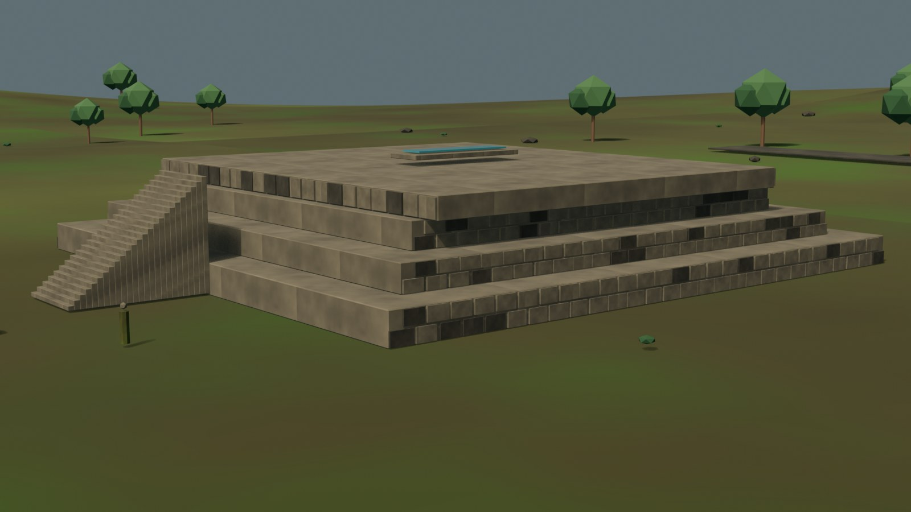
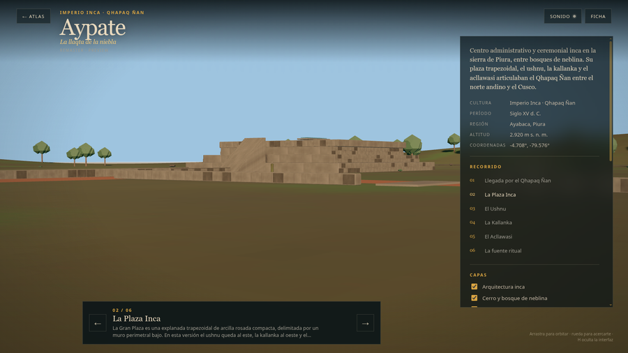
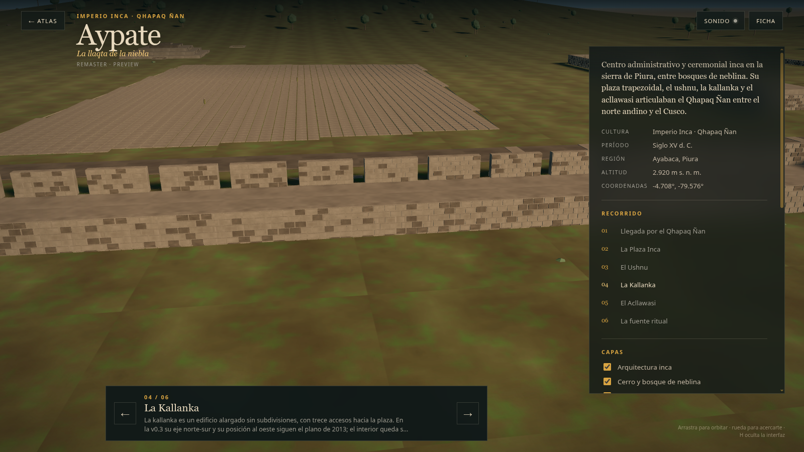

# Aypate — remaster

Estado: **preview web v0.4 con high-poly navegable; escala contrastada con el plano de 2013; cotas finas cerradas como no alcanzables con fuente pública; recintos periféricos diferidos; QA de hardware pendiente**.
Fuente: `blender/aypate/aypate_highpoly_v0.4.blend` (8,9 MB).
LOD0: **209.560 tris / 2.139.720 B**; LOD1: **30.663 tris / 443.372 B**; 15/15 draw calls.
Caché por hash generada en build.

Aypate es un centro administrativo y ceremonial inca del siglo XV, en el bosque de neblina de Ayabaca. El high-poly modela el núcleo documentado —plaza, ushnu, kallanka, acllawasi, palacio, colcas, fuente, andenes y Qhapaq Ñan— con una composición macro basada en el levantamiento publicado de 2013; los detalles no conservados siguen siendo interpretativos. La puerta escaneada de Sketchfab se usa como referencia, no como asset del GLB.

## Documentos

- `plan.md`: alcance, presupuesto, recorrido, riesgos y gate de Fase 0.
- `cobertura.md`: elementos documentados, inferidos y diferidos.
- `referencias.md`: fuentes, licencias y criterios de imagen.
- `web-preview.md`: assets, métricas, QA y límites del preview.
- `auditoria-plano-2013.md`: comparación y corrección del layout macro.
- `escala.md`: tabla de dimensiones y decisiones de escala v0.4.
- `cotas.md`: cierre documental de cotas de conjunto y límites.
- Dossier de fuentes: [`../../fuentes/aypate.md`](../../fuentes/aypate.md).

## Vistas

### High-poly, cámara hero

### Plaza Inca en el visor

### Kallanka

## Pase de atmósfera — 5 de noviembre de 2026

- Reencuadre de la parada 2 (La Plaza Inca): cámara `[2.0, 2.2, 4.5]`, objetivo `[6.5, 0.4, -2.0]` y `fov 32`.
- Niebla `8–65` para fundir el terreno lejano con el cielo y reforzar la lectura de bosque de neblina.
- Override de mañana (`fill 0.45`, `hemiIntensity 0.22`, `envIntensity 0.55`) y override de noche para conservar contraste.
- Sin cambios de geometría, GLB, hashes ni caché de modelos.
- Evidencia y capturas antes/después: [`../../qa/revision-atmosfera-aypate-2026-11-05.md`](../../qa/revision-atmosfera-aypate-2026-11-05.md).

## Límites

- El plano general de 2013 está publicado como figura en Campos 2017; la memoria de 36 sectores y el original de alta resolución no son públicos.
- La v0.4 conserva el layout macro y corrige escala; ver `escala.md` y `auditoria-plano-2013.md`.
- Las cotas finas se cierran como no alcanzables con fuente pública (4 nov 2026); queda la QA móvil/1080p. El desktop integrado 1600×900 pasó LOD0/LOD1.
- No se reconstruyen techos, alturas perdidas ni recintos periféricos; estos se señalizan en la ficha como diferidos.
- La vegetación y la niebla son una lectura de ambiente, no un inventario botánico.
- No hay QA v0.4 en hardware real.
- El escaneo de la puerta no se incorporó; si se integra, requiere retopología, material propio y atribución CC BY.
