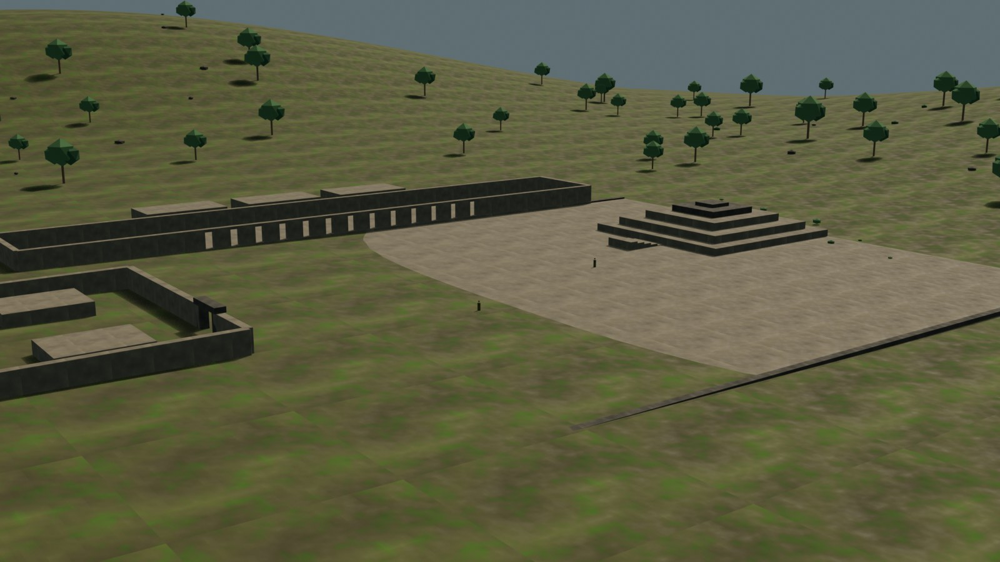

# Aypate — remaster

Estado: **preview web v0.1 con blockout navegable; no reconstrucción final**.
Fuente: `blender/aypate/aypate_blockout_v0.1.blend` (1,8 MB).
LOD0: **43.420 tris / 393.908 B**; LOD1: **14.252 tris / 287.028 B**; 16/14 draw calls.
Caché `v23`.

Aypate es un centro administrativo y ceremonial inca del siglo XV, en el bosque de neblina de Ayabaca. El blockout modela el núcleo documentado —plaza, ushnu, kallanka, acllawasi, palacio, colcas, fuente, andenes y Qhapaq Ñan— y marca la composición como interpretativa, porque la planta topográfica completa no está publicada. La puerta escaneada de Sketchfab se usa como referencia, no como asset del GLB.

## Documentos

- `plan.md`: alcance, presupuesto, recorrido, riesgos y gate de Fase 0.
- `cobertura.md`: elementos documentados, inferidos y diferidos.
- `referencias.md`: fuentes, licencias y criterios de imagen.
- `web-preview.md`: assets, métricas, QA y límites del preview.
- Dossier de fuentes: [`../../fuentes/aypate.md`](../../fuentes/aypate.md).

## Vistas

### Blockout, cámara hero

### Plaza Inca en el visor

### Kallanka

## Límites

- La planta completa no está publicada: la composición es una hipótesis de trabajo, no un levantamiento.
- No se reconstruyen techos, alturas perdidas ni todos los recintos periféricos.
- La vegetación y la niebla son una lectura de ambiente, no un inventario botánico.
- No hay QA v0.1 en hardware real.
- El escaneo de la puerta no se incorporó; si se integra, requiere retopología, material propio y atribución CC BY.
