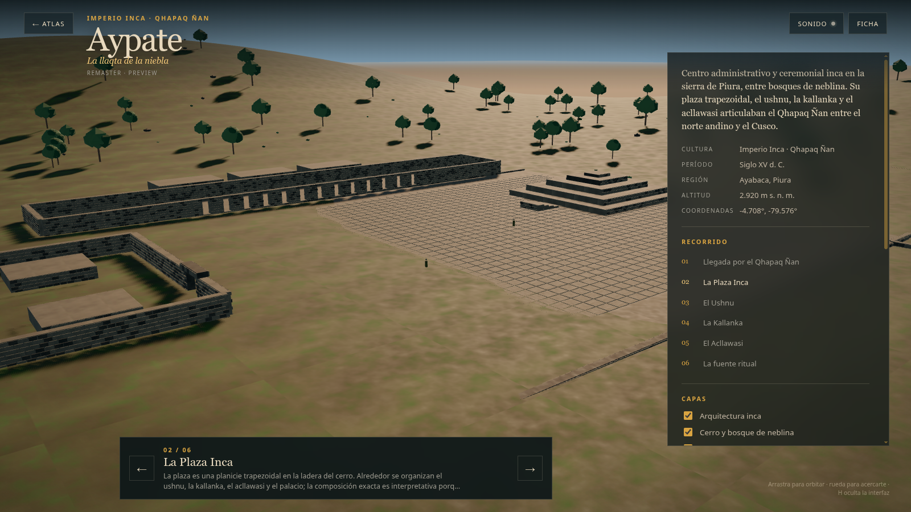
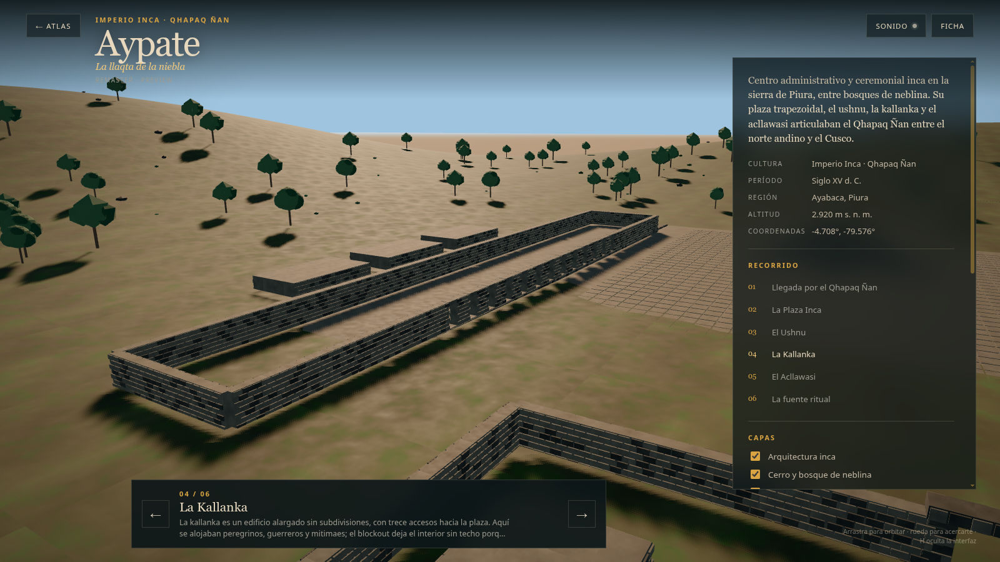
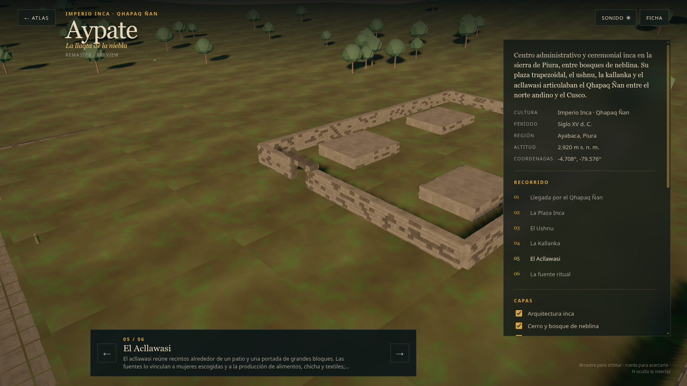

# Aypate — preview web v0.2

Fecha: 28 de octubre de 2026.
Estado: **preview público controlado; high-poly, no reconstrucción final**.
Modelo: `public/cities/aypate/model_lod0.glb` y `model_lod1.glb`.
Fuente: `blender/aypate/aypate_highpoly_v0.2.blend`; los LOD se regeneran con `scripts/build_aypate_lod.py` y no se versionan.

## Qué se integró

- `city.json` con `status: "available"` y `stage: "preview"`.
- LOD0 de 241.436 tris / 2.204.924 B; LOD1 de 31.623 tris / 459.108 B.
- 16 y 14 draw calls en la vista inicial; 8 materiales y 12 imágenes 2K/1K px.
- Seis paradas: Qhapaq Ñan, plaza, ushnu, kallanka, acllawasi y fuente ritual.
- Capas: arquitectura inca, cerro y bosque de neblina, detalles y escala humana.
- `scale: 0.08`, `minDistance: 0.1` y `maxDistance: 180`.
- Caché `v24`.

## Vistas

### Plaza Inca

### Kallanka

### Acllawasi

## Métricas

| Métrica | LOD0 | LOD1 |
|---|---:|---:|
| Triángulos | 241.436 | 31.623 |
| GLB | 2.204.924 B | 459.108 B |
| Mallas exportadas | 4 | 4 |
| Draw calls | 16 | 14 |
| Materiales / imágenes | 8 / 12 | 8 / 12 |
| Texturas decodificadas | 256 MB | 64 MB |

- `?lod=0` fuerza LOD0; `?lod=1` fuerza LOD1.
- Móvil emulado selecciona LOD1.
- No hay fallback v1 independiente: LOD1 es el fallback.
- El bench de SwiftShader no certifica FPS.

## QA ejecutado

- `npm run validate`: OK (6 ciudades, 3 disponibles).
- `npm run build`: OK.
- Bench LOD0/LOD1/móvil: OK, sin errores de consola.
- Seis paradas capturadas; revisadas las cámaras 2 (plaza), 4 (kallanka) y 5 (acllawasi).
- Sin imágenes oficiales ni texturas de IA.

## Límites

- La planta completa de Aypate no está publicada; el layout es interpretativo.
- Los edificios se muestran sin techos y con volúmenes de high-poly; el layout sigue siendo interpretativo.
- La vegetación y la niebla son una lectura ambiental, no un inventario.
- No hay QA en hardware real todavía.
- La puerta escaneada de Sketchfab no se incorporó al GLB; solo se usó como referencia.
- El preview no debe presentarse como remaster final.
