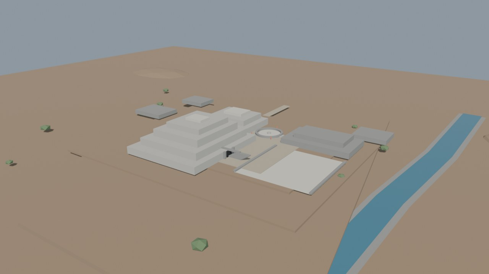
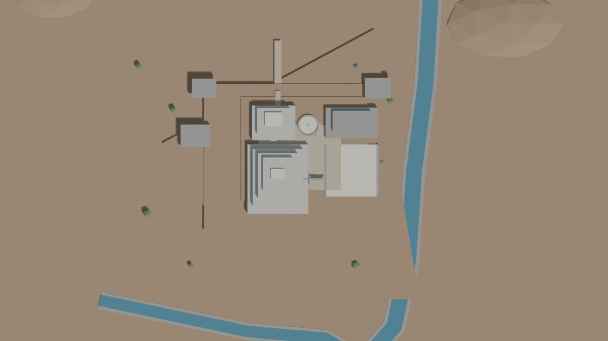
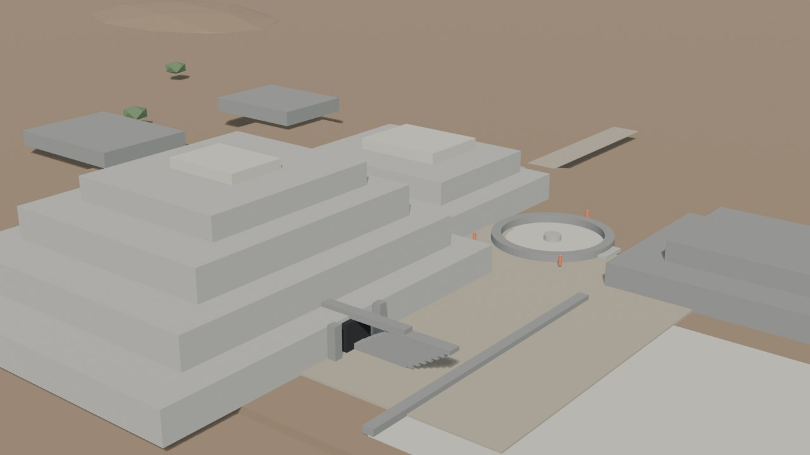

# Chavín — blockout v0.1

Fecha: 27 de octubre de 2026.
Estado: **generado y guardado; revisión pendiente**.
Fuente: `blender/chavin/chavin_blockout_v0.1.blend` (162 KB).

## Vistas

### Hero — sureste, fachada este del Edificio A

### Planta — comparación con PE-330

### Núcleo — Edificio A, Edificio B y Plaza Circular

## Qué contiene

| Elemento | Blockout | Evidencia |
|---|---|---|
| Explanada del sitio | 295,9 × 313,7 m; 3 m de espesor | Cuatro puntos del plano PE-330 |
| Terrazas | 210 × 170 / 145 × 120 / 95 × 75 m | Inferido a partir del plano |
| Edificio A / Pirámide Mayor / “Castillo” | 70 × 80 m; 4 terrazas + cima; ~22,5 m + 2 m | Altura documentada; huella inferida |
| Portada de las Falcónidas | Pórtico y puerta oscura en fachada este | Documentado; simplificado |
| Edificio B / Templo del Lanzón | 50 × 40 m; 3 niveles; ~15,25 m | Huella y altura inferidas |
| Galería del Lanzón | Portal, túnel y dinteles | Documentado; solo acceso |
| Plaza Circular / Atrio | Radio 12,5 m; muro anular de 2 m; altar | Presencia documentada; diámetro inferido |
| Plataforma Norte / Edificio D | 60 × 35 m; dos niveles | Documentado; huella inferida |
| Plaza Cuadrada / Plaza Mayor | 60 × 60 m; muros laterales | Documentado; dimensiones inferidas |
| Edificios C/E/F | Plataformas de fondo | Contexto del plano; sin detalle |
| Caminos, ríos y valle | Eje norte, Mosna/Wacheqsa, laderas | Aproximación al plano; sin DEM |
| Escala humana | Cinco referencias de 1,7 m | Interpretativo |

## Métricas

- 71 mallas, 1.758 vértices y **3.198 tris**.
- 8 colecciones: terreno, arquitectura, plazas, detalles, referencia, luces, cámaras.
- Cámaras: `CAM-Chavin_Hero`, `CAM-Chavin_Plan`, `CAM-Chavin_Core`.
- Luces: `LGT-Chavin_Sun` y `LGT-Chavin_Fill`.
- Render: EEVEE, 1280×720, 32 muestras.
- Sin texturas, sin imágenes oficiales y sin geometría de IA.

## Evidencia e inferencia

**Documentado o verificado en fuentes:**

- Huella del sitio y orientación general, a partir de los puntos PE-330.
- Edificio A como Pirámide Mayor / “Castillo”, con fachada este y Portada de las Falcónidas.
- Edificio B / Templo del Lanzón y la Galería del Lanzón.
- Plaza Circular/Atrio del Lanzón, Plataforma Norte y Plaza Cuadrada.
- Altura del Edificio A: ~22,5 m + ~2 m de recintos de cima.

**Inferido o interpretativo:**

- Huellas de B, D, C, E y F; alturas de B y D.
- Diámetro de la Plaza Circular y dimensiones de la Plaza Cuadrada.
- Trazado exacto de terrazas, caminos, ríos y laderas.
- Distribución de vanos, dinteles, escaleras y muros.
- Figuras humanas y vegetación.

## Límites de esta versión

- No hay galerías interiores completas: solo el portal de la Galería del Lanzón.
- No hay Lanzón, Estela, Obelisco, cabezas clavas ni relieves.
- No hay techos, cubiertas ni hipótesis de altura interior.
- No hay DEM fino; el terreno es una explanada con terrazas y laderas aproximadas.
- Los materiales son colores planos de blockout, no look-dev.
- La Plaza Circular es un anillo de blockout, no una reconstrucción métrica.
- No se ha comparado todavía con fotografías autorizadas ni con secciones de detalle.

## Revisión recomendada

1. Comparar la planta renderizada con PE-330 y corregir huellas/ejes.
2. Revisar la relación Edificio A/B/Plaza Circular y la fachada este.
3. Decidir si el terreno se modela con DEM o con laderas procedurales marcadas como inferidas.
4. Añadir una secuencia de galería y el volumen del Lanzón.
5. Solo después: materiales, detalle, LOD y export.
