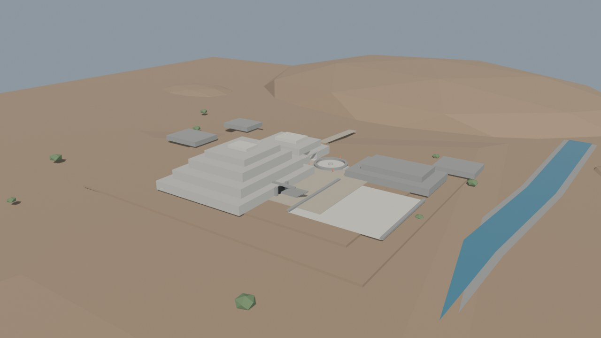
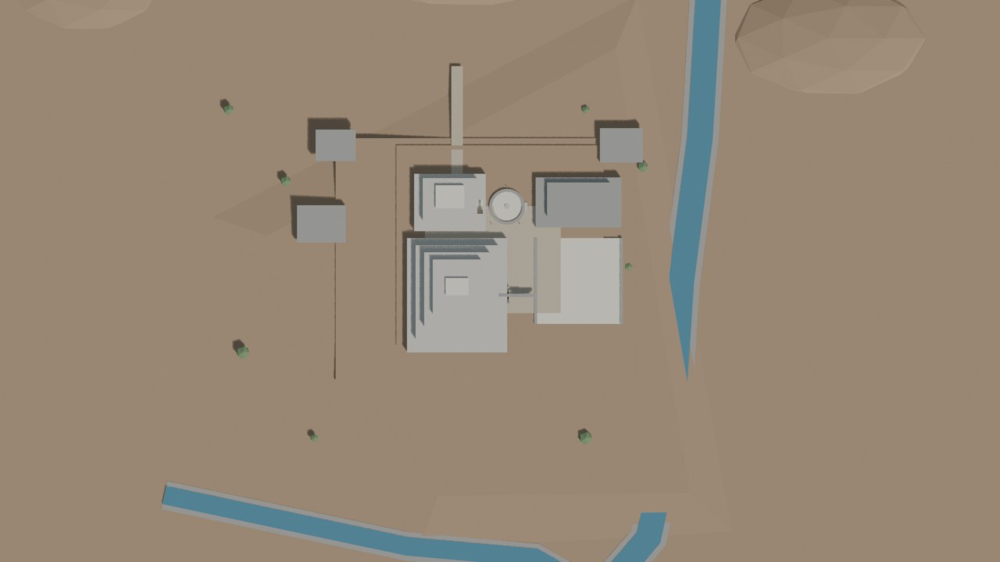
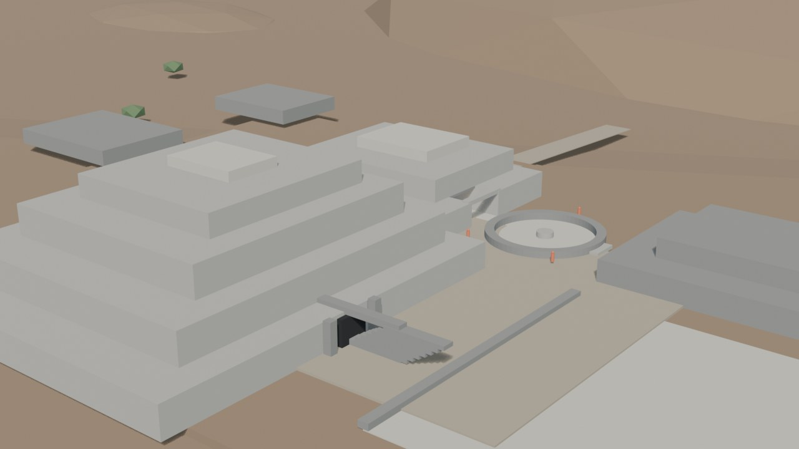
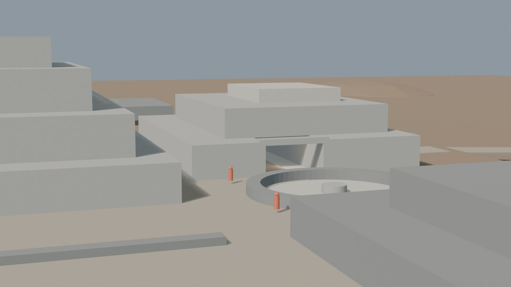
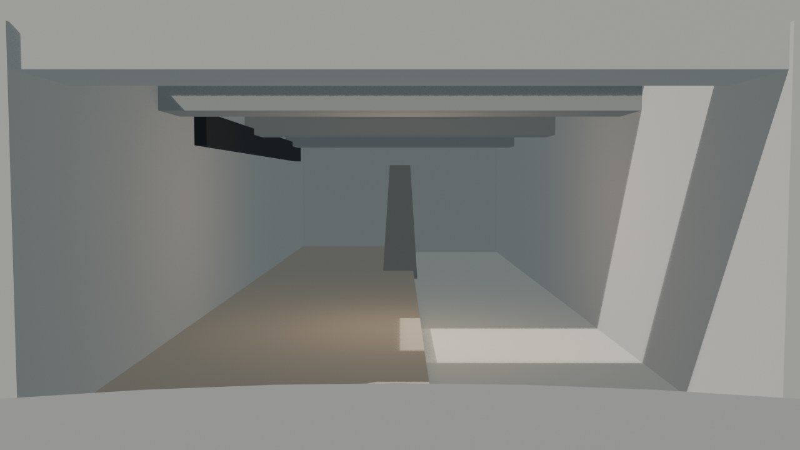

# Chavín — blockout v0.2 (pase de terreno)

Fecha: 27 de octubre de 2026.
Estado: **pase de terreno generado; revisión pendiente**.
Fuente: `blender/chavin/chavin_blockout_v0.2.blend` (170 KB).
Base anterior: `blockout-v0.1.md`.

## Vistas

### Hero

### Planta

### Núcleo

### Galería

### Lanzón

## Qué cambió respecto a v0.1

- **Explanada:** se mantiene la huella PE-330 de **295,9 × 313,7 m**, ahora con una tapa fina de 0,3 m.
- **Talud perimetral:** nueva falda de 40 m que baja de `z=0` a `z=-2,8`; sustituye el borde vertical del blockout.
- **Terreno de valle:** se añadieron bancos de río y una ladera norte de contexto.
- **Acceso norte:** rampa de 60 m que sube de `z≈0,1` a `z≈3,0` y aterriza en la terraza 2; se eliminaron los caminos flotantes anteriores.
- **Terraza 2:** se extendió 20 m al norte para recibir la rampa.
- **Cerro Cochas:** volumen de fondo al norte; se desactiva su sombra para que no oscurezca el conjunto en el blockout.
- **Núcleo:** sin cambios de masa respecto a v0.1; se conservan Edificio A/B, Plaza Circular, galería y Lanzón.

## Métricas

- 79 mallas, 1.862 vértices y **3.352 tris**.
- 8 colecciones.
- Cámaras: `CAM-Chavin_Hero`, `CAM-Chavin_Plan`, `CAM-Chavin_Core`, `CAM-Chavin_Gallery`, `CAM-Chavin_Lanzon`.
- Luces: `LGT-Chavin_Sun`, `LGT-Chavin_Fill`, `LGT-Chavin_GalleryFill`.
- Render: EEVEE, 1280×720, 32 muestras.
- Sin texturas, sin imágenes oficiales y sin geometría de IA.

## Evidencia e inferencia

**Documentado/verificado:**

- Huella del sitio, orientación y puntos PE-330.
- Edificio A, Edificio B, Plaza Circular, Plataforma Norte y Plaza Cuadrada.
- Altura del Edificio A: ~22,5 m + ~2 m de cima.

**Inferido en este pase:**

- Pendiente, talud y espesor de la explanada.
- Trazado y ancho de los bancos de río.
- Rampa de acceso norte y altura del aterrizaje.
- Cerro Cochas y laderas de fondo.
- Huellas de B/C/D/E/F y dimensiones de las plazas.
- Volumen del Lanzón.

## Límites

- No hay DEM: el terreno es una aproximación procedural. La opción DEM queda pendiente de fuente.
- El talud perimetral y los bancos de río son de blockout, no topografía.
- No hay materiales finales, texturas, relieves, techos ni galerías completas.
- El Lanzón sigue siendo un volumen ahusado sin talla.
- La sombra del Cerro Cochas está desactivada solo para legibilidad del blockout; no es una decisión de iluminación final.

## Revisión recomendada

1. Revisar la rampa norte y el aterrizaje en la terraza.
2. Revisar el talud perimetral y los bancos de río contra el plano.
3. Decidir si se consigue un DEM o se mantiene el terreno procedural.
4. Ajustar huellas de B/D y la relación con la Plaza Circular.
5. Después: detalle de galería/Lanzón y materiales.
