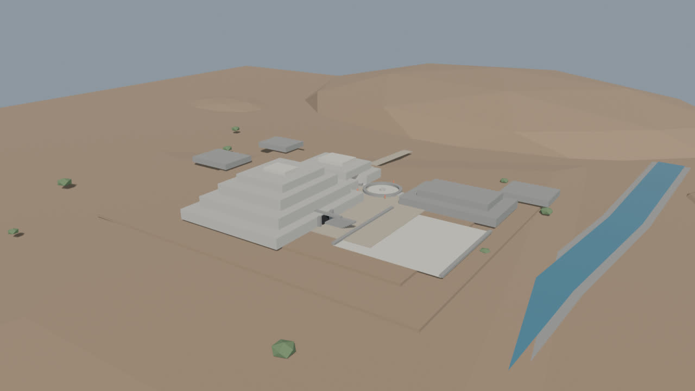
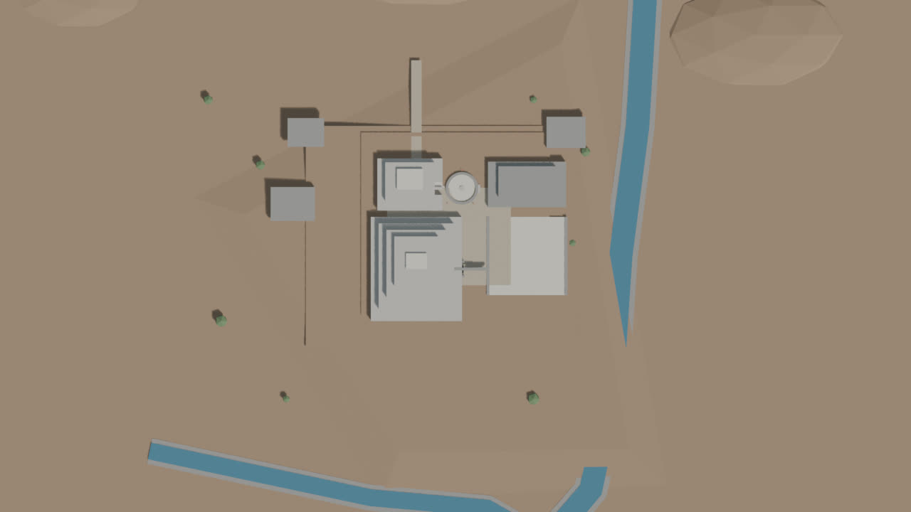
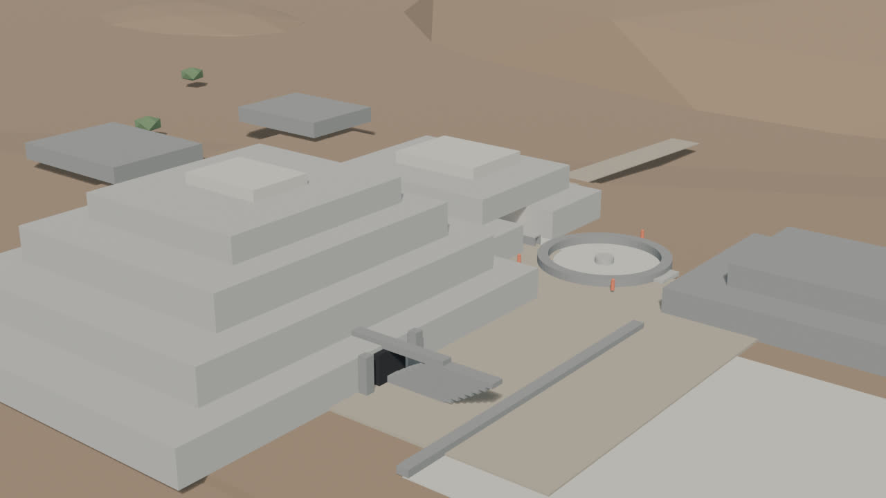
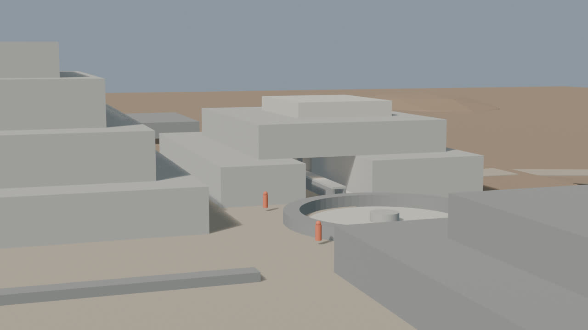
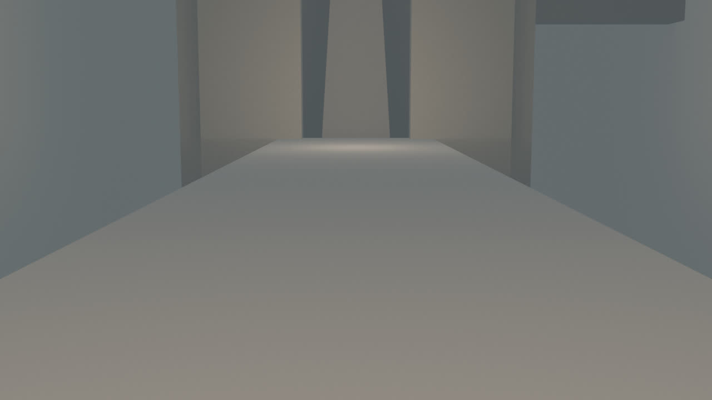
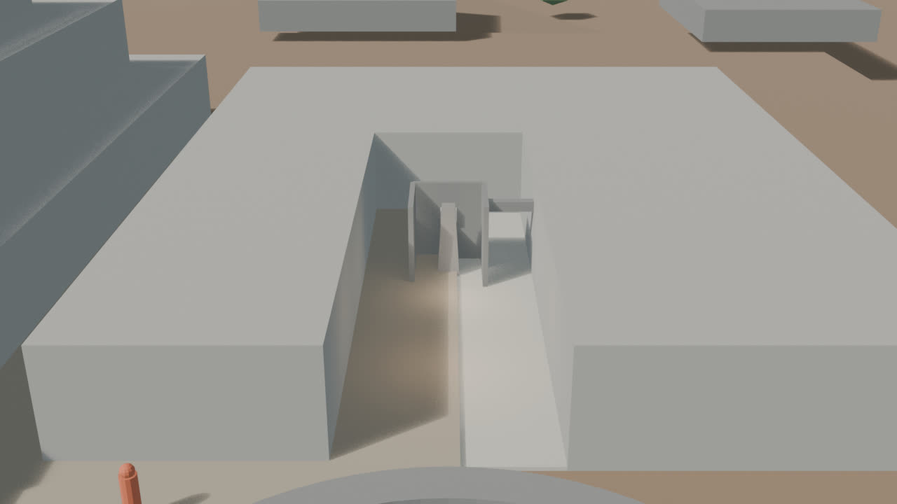

# Chavín — blockout v0.3 (núcleo hero)

Fecha: 27 de octubre de 2026.
Estado: **histórico; sustituido por v0.4, que cierra el patio de B**.
Fuente: `blender/chavin/chavin_blockout_v0.3.blend` (174 KB).
Base: `blockout-v0.2.md`. Siguiente: `blockout-v0.4.md`.
Decisión de terreno: `terrain.md`.

## Vistas

### Hero

### Planta

### Núcleo

### Galería

### Lanzón

### Sección de revisión

## Qué cambió respecto a v0.2

- **Galería:** se sustituyó el nicho abierto de 10 m por una secuencia acotada.
  - Corredor de acceso de ~18 m, 1,4 m de ancho y 2,2 m de alto.
  - Cámara del Lanzón de ~4,3 × 4,3 m y 5,2 m de alto.
  - Dinteles de piedra, umbral de acceso y una hornacina.
  - Ducto de ventilación de 0,5 × 0,5 m.
- **Lanzón:** se conserva el volumen ahusado de ~4,5 m; se subió ligeramente la legibilidad con un relleno de revisión.
- **Núcleo:** sin cambios de huella; se mantiene la relación B–Plaza Circular y el acceso este.
- **Terreno:** sin cambios; se acepta el pase procedural de v0.2 y se documenta en `terrain.md`.
- **Cámara nueva:** `CAM-Chavin_Section`, para revisar la galería con los techos y el volumen superior de B ocultos.
- **Nota de render:** las vistas de Lanzón y sección ocultan muros/techos para leer el interior. **No es un corte físico del modelo**; la escena guardada conserva toda la geometría.

## Métricas

- 89 mallas, 1.942 vértices y **3.472 tris**.
- 8 colecciones.
- Cámaras: `CAM-Chavin_Hero`, `CAM-Chavin_Plan`, `CAM-Chavin_Core`, `CAM-Chavin_Gallery`, `CAM-Chavin_Lanzon`, `CAM-Chavin_Section`.
- Luces: `LGT-Chavin_Sun`, `LGT-Chavin_Fill`, `LGT-Chavin_GalleryFill`, `LGT-Chavin_LanzonFill`.
- Render: EEVEE, 1280×720, 32 muestras.
- `npm run validate` y `npm run build`: OK.
- Sin texturas, sin imágenes oficiales y sin geometría de IA.

## Evidencia e inferencia

**Documentado/verificado:**

- Edificio B como plataforma en “U” y su relación con la Plaza Circular/Atrio del Lanzón.
- 22 galerías estudiadas, 689,70 m de longitud, 120 ductos y 56 hornacinas.
- El conteo de vigas varía según la fuente: 1.140–1.385; se usa 1.349 como cifra de trabajo, no como cota cerrada.
- Galerías altas: ≥1,9 m; ancho típico ~1 m; ductos: ≤0,5 m.
- Lanzón como monolito in situ, pieza central de la Galería del Lanzón.

**Inferido en este pase:**

- Longitud exacta del corredor y de la cámara.
- Altura de 5,2 m de la cámara y 2,2 m del corredor.
- Posición y forma del ducto y de la hornacina.
- Separación de dinteles y umbral.
- Proporción y altura de ~4,5 m del Lanzón.
- Cualquier lectura de la sección: es una herramienta de revisión, no una sección arqueológica.

## Límites

- Se modela **una secuencia**, no las 22 galerías.
- La planta y las alturas de la galería son una aproximación de blockout; faltan secciones finas.
- El Lanzón sigue sin talla, rostro, textura ni detalles de superficie.
- No hay materiales finales, iluminación final, techos reconstructivos ni piezas de museo.
- El terreno sigue siendo procedural; no hay DEM ni levantamiento topográfico.
- Las imágenes de sección/Lanzón ocultan geometría para revisión; no deben publicarse como corte del monumento.
- No hay assets web, `city.json` ni GLB de Chavín.

## Revisión recomendada

1. Verificar el ancho y la altura del corredor contra la sección.
2. Revisar la escala del Lanzón y su posición en la cámara.
3. Confirmar que la galería abre correctamente hacia la Plaza Circular.
4. Revisar la relación de huellas A/B antes de añadir materiales.
5. Decidir DEM vs. procedural antes de look-dev; no cambiar el terreno en este pase.
6. Después: materiales sobrios, portada de las Falcónidas y LOD.
