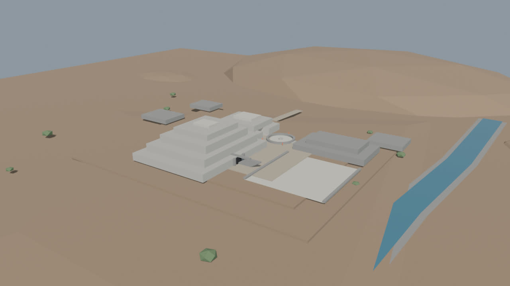
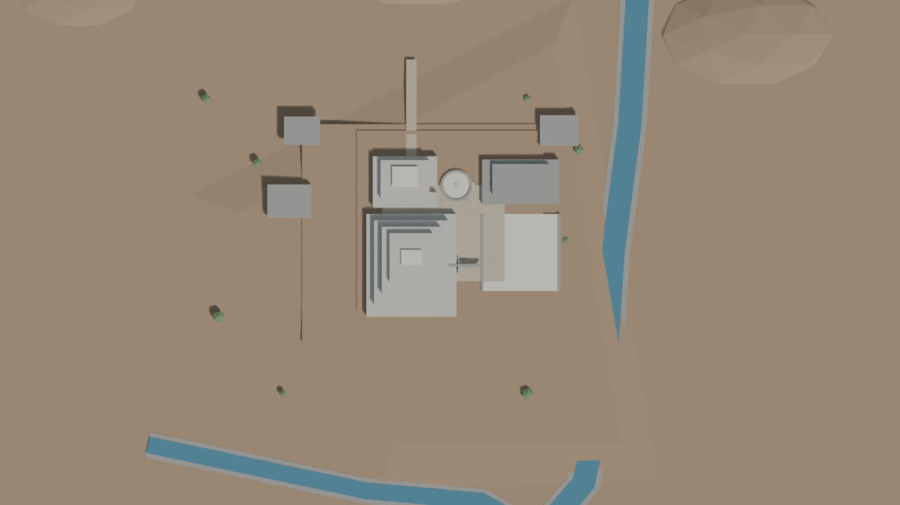
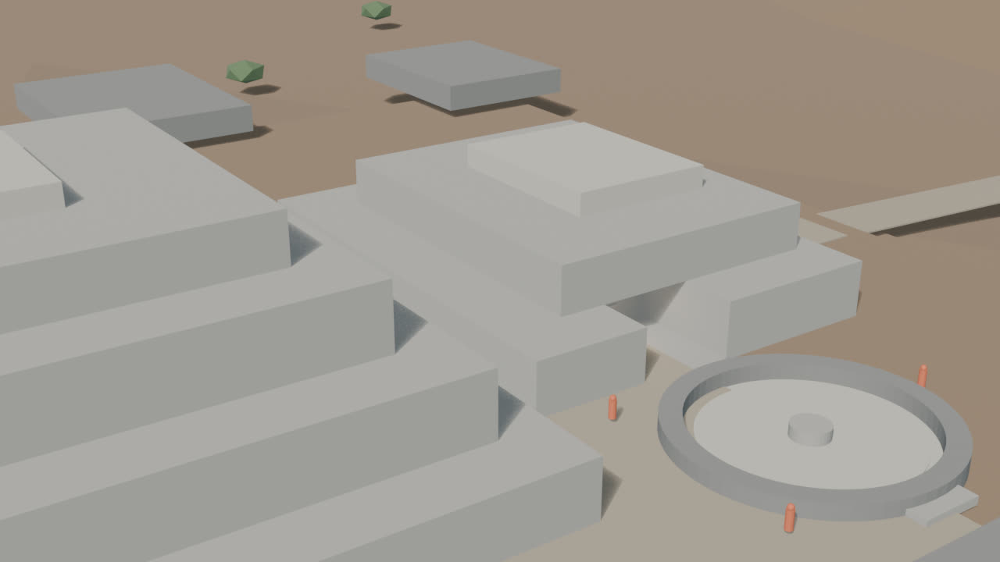
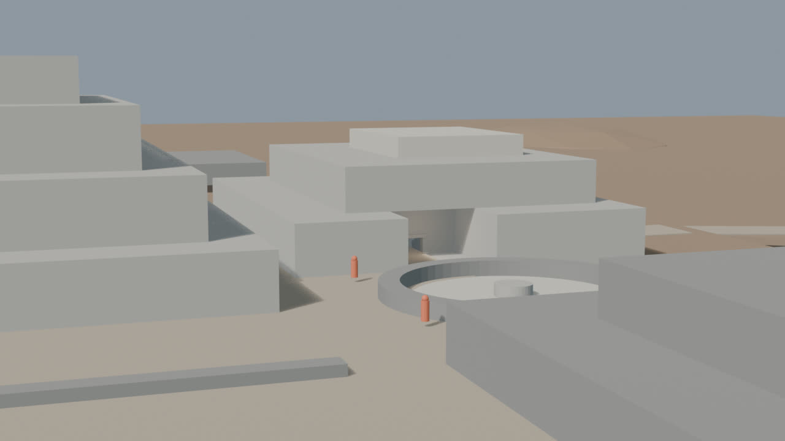
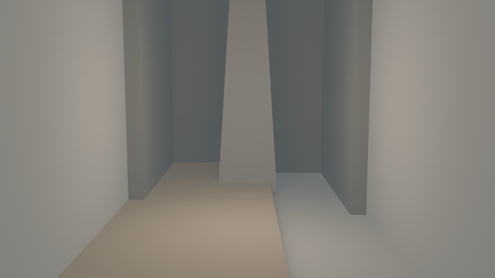
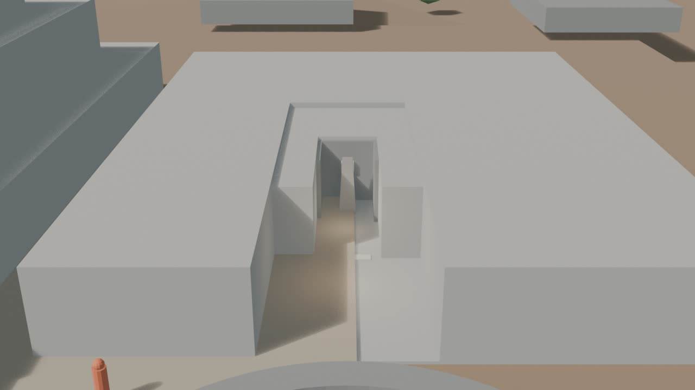

# Chavín — blockout v0.4 (cierre del núcleo B)

Fecha: 27 de octubre de 2026.
Estado: **núcleo B cerrado en blockout; revisión pendiente**.
Fuente: `blender/chavin/chavin_blockout_v0.4.blend` (175 KB).
Base: `blockout-v0.3.md`.
Decisión de terreno: `terrain.md`.

## Vistas

### Hero

### Planta

### Núcleo

### Galería

### Lanzón

### Sección de revisión

## Qué cambió respecto a v0.3

- **Patio de B:** el nicho abierto de 30 m de profundidad se sustituyó por un patio de ~12 × 10 m.
- **Masa de B:** se rellenó el volumen alrededor de la galería con seis bloques (`GEO-Chavin_B_Fill_*`), dejando la galería dentro de la plataforma.
- **Acceso:** el portal se trasladó al borde oeste del patio (`x=8`); el corredor interior mide ~6 m.
- **Portal:** se añadieron dintel de portal y umbral; el corredor conserva sus dos dinteles.
- **Piso:** la losa de galería/patio pasó de plaster claro a piedra, para evitar la lectura de “losa flotante”.
- **Cámara de núcleo:** se elevó para mostrar A, B, el patio y la Plaza Circular sin quedar dentro de las masas.
- **Sin cambios:** Edificio A, Plaza Circular, terreno, ríos y Lanzón.

## Métricas

- 95 mallas, 1.990 vértices y **3.544 tris**.
- 8 colecciones.
- Cámaras: `CAM-Chavin_Hero`, `CAM-Chavin_Plan`, `CAM-Chavin_Core`, `CAM-Chavin_Gallery`, `CAM-Chavin_Lanzon`, `CAM-Chavin_Section`.
- Luces: `LGT-Chavin_Sun`, `LGT-Chavin_Fill`, `LGT-Chavin_GalleryFill`, `LGT-Chavin_LanzonFill`.
- Render: EEVEE, 1280×720, 32 muestras.
- `npm run validate` y `npm run build`: OK.
- Sin texturas, sin imágenes oficiales y sin geometría de IA.

## Evidencia e inferencia

**Documentado/verificado:**

- Edificio B como plataforma en “U” y su relación con el atrio y la Plaza Circular.
- 22 galerías, 689,70 m lineales, 120 ductos y 56 hornacinas.
- Conteo de vigas: 1.349 como cifra de trabajo; otras lecturas dan 1.140–1.385.
- Galerías altas ≥1,9 m; ancho típico ~1 m; ductos ≤0,5 m.
- Lanzón in situ como pieza central de la Galería del Lanzón.

**Inferido en este pase:**

- Patio de B de ~12 × 10 m y su profundidad.
- Extensión y altura del relleno de B alrededor de la galería.
- Posición del portal en el borde oeste del patio.
- Longitud de 6 m del corredor interior y separación de dinteles.
- Altura de 5,2 m de la cámara y 2,2 m del corredor.
- Proporción y altura de ~4,5 m del Lanzón.

## Límites

- El patio y el relleno de B son una **hipótesis de blockout**; no hay planta fina de esa zona.
- Se modela **una secuencia**, no las 22 galerías.
- El Lanzón sigue sin talla, rostro, textura ni detalles de superficie.
- No hay materiales finales, iluminación final, techos reconstructivos ni piezas de museo.
- El terreno sigue siendo procedural; no hay DEM ni levantamiento topográfico.
- Las vistas de Lanzón y sección ocultan muros/techos/relleno para revisión. **No son un corte físico** ni una sección arqueológica.
- No hay assets web, `city.json` ni GLB de Chavín.

## Revisión recomendada

1. Comparar el patio de B con el plano y el atrio de la Plaza Circular.
2. Verificar que el portal y el corredor no queden demasiado estrechos para la cámara.
3. Revisar la escala del Lanzón dentro de la cámara.
4. Revisar la relación A/B y el acceso desde la plaza antes de materiales.
5. Decidir DEM vs. procedural antes de look-dev.
6. Después: materiales sobrios, Portada de las Falcónidas y LOD.
