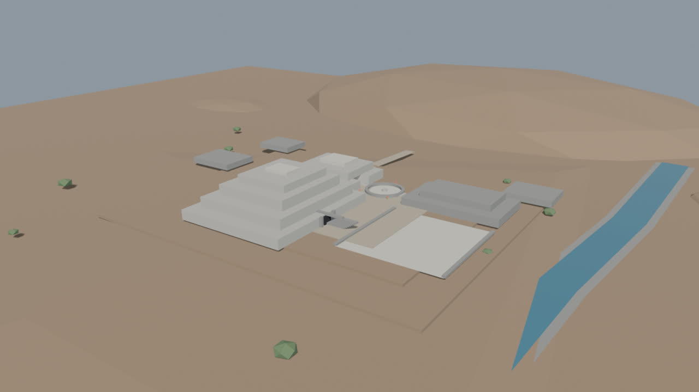
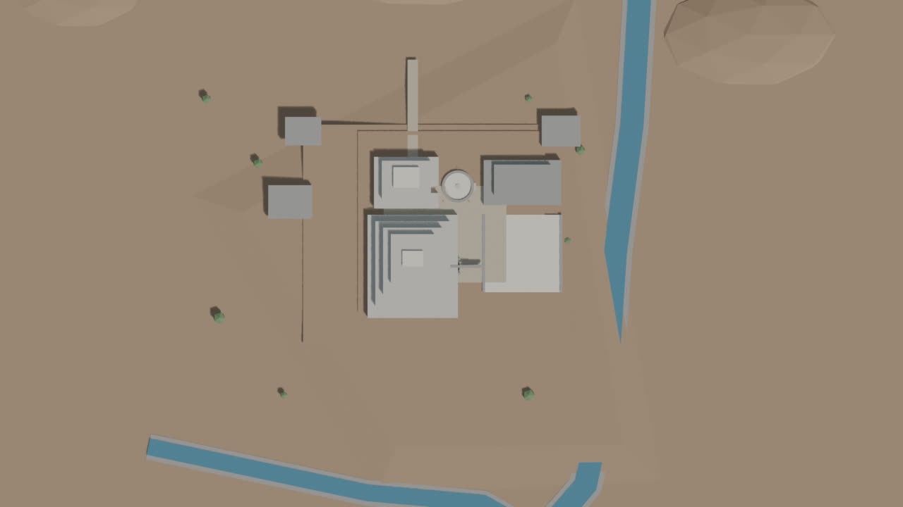
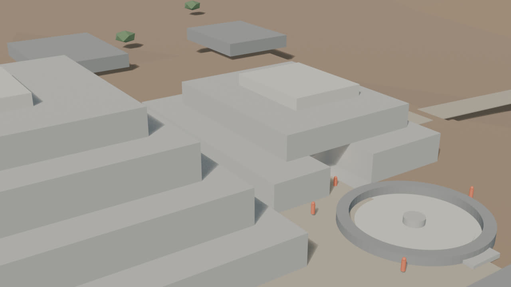
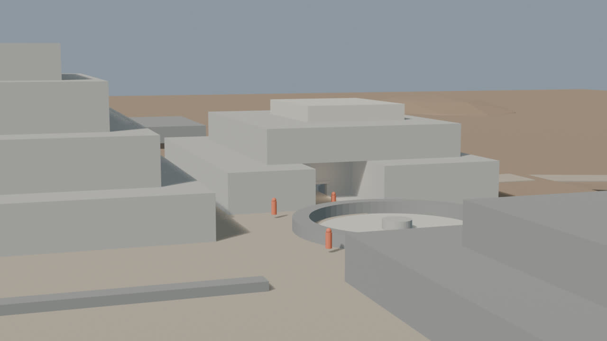
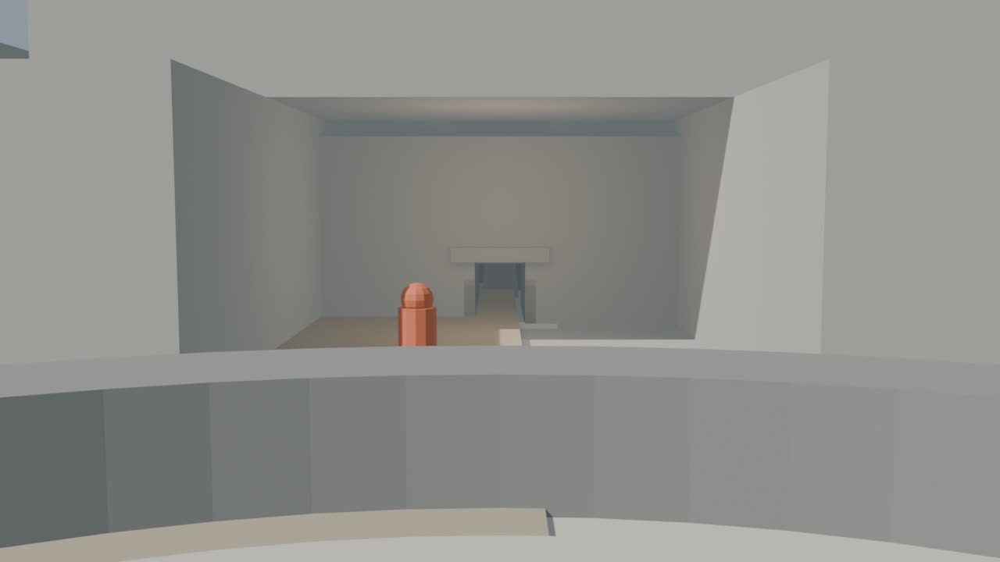
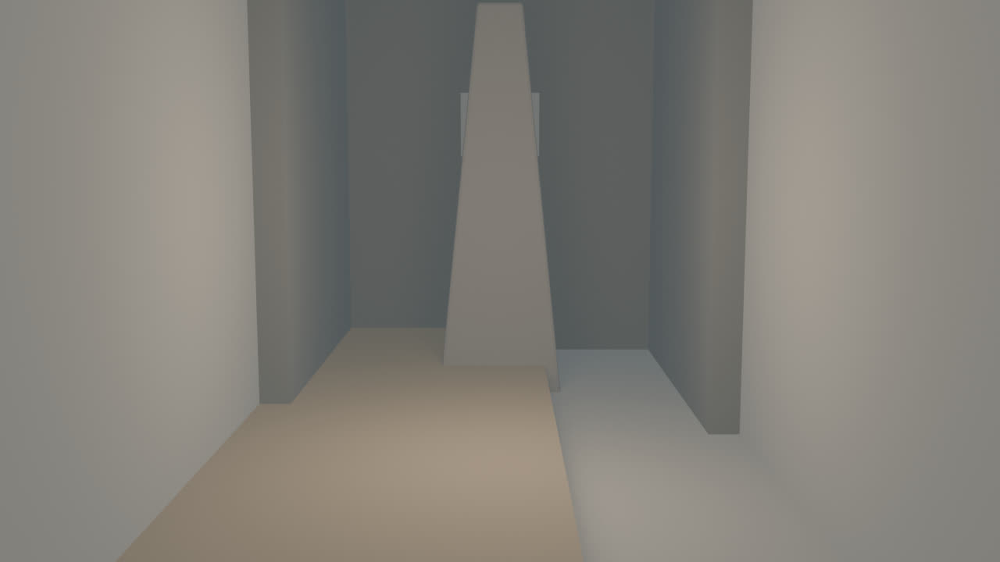
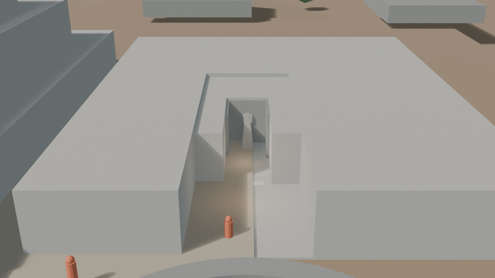

# Chavín — blockout v0.5 (revisión de escala)

Fecha: 27 de octubre de 2026.
Estado: **aceptada como base de escala; ver `lookdev-v0.2.md`**.
Fuente: `blender/chavin/chavin_blockout_v0.5.blend` (176 KB).
Base: `blockout-v0.4.md`.
Decisión de terreno: `terrain.md`.

## Vistas

### Hero

### Planta

### Núcleo

### Galería

### Portal y atrio

### Lanzón

### Sección de revisión

## Qué cambió respecto a v0.4

- **Lanzón:** se sustituyó el cono octogonal por un prisma ahusado de sección rectangular, más próximo a la lectura de “lanza”/cuña. Dimensiones: 0,97 × 1,47 × 4,5 m.
- **Cámara del Lanzón:** se retrocedió a 14 m y se elevó el objetivo para mostrar la pieza completa, con margen superior.
- **Escala humana:** se añadió una figura de referencia de 1,7 m en el atrio de B (`GEO-Chavin_HumanScale_06`), junto al portal.
- **Nueva cámara `CAM-Chavin_Portal`:** vista desde la Plaza Circular hacia el portal, con la figura de escala.
- **Patio y portal:** se revisaron y se mantuvieron las dimensiones de v0.4 (patio ~12 × 10 m; portal ~1,4 × 2,2 m). No hay planta fina que justifique otro ajuste.
- **Sin cambios:** Edificio A, Plaza Circular, terreno, ríos y el resto de la galería.

## Métricas

- 97 mallas, 2.148 vértices y **3.852 tris**.
- 8 colecciones.
- Cámaras (7): `CAM-Chavin_Hero`, `CAM-Chavin_Plan`, `CAM-Chavin_Core`, `CAM-Chavin_Gallery`, `CAM-Chavin_Portal`, `CAM-Chavin_Lanzon`, `CAM-Chavin_Section`.
- Luces: `LGT-Chavin_Sun`, `LGT-Chavin_Fill`, `LGT-Chavin_GalleryFill`, `LGT-Chavin_LanzonFill`.
- Render: EEVEE, 1280×720, 32 muestras.
- `npm run validate` y `npm run build`: OK.
- Sin texturas, sin imágenes oficiales y sin geometría de IA.

## Evidencia e inferencia

**Documentado/verificado:**

- Altura del Lanzón: ~4,5 m.
- Lanzón como pieza central de una cámara dentro de la galería.
- Edificio B como plataforma en “U”, atrio y relación con la Plaza Circular.
- 22 galerías, 689,70 m lineales, 120 ductos y 56 hornacinas.
- Galerías altas ≥1,9 m; ancho típico ~1 m; ductos ≤0,5 m.
- Conteo de vigas: 1.349 como cifra de trabajo; rango 1.140–1.385.

**Inferido en este pase:**

- Sección rectangular ahusada y ancho de ~1,5 m del Lanzón.
- Patio de B de ~12 × 10 m.
- Portal de ~1,4 × 2,2 m y su posición en el borde oeste del patio.
- Altura de 5,2 m de la cámara y 2,2 m del corredor.
- Figura de 1,7 m como referencia de escala, no como reconstrucción de vestimenta ni de personas.

## Revisión de escala

- La figura de 1,7 m deja el dintel del portal a unos 0,5 m por encima de su cabeza; el vano es estrecho, como corresponde a una galería.
- El patio sigue leyéndose profundo y el portal pequeño; se mantiene porque no hay una planta fina publicada que permita corregirlo con evidencia.
- El Lanzón completo entra en la cámara y en el encuadre; la cámara ya no corta la parte superior.
- La nueva vista de portal permite comparar vano, dintel, umbral y figura humana.

## Límites

- El Lanzón sigue siendo un volumen: **no tiene rostro, talla, textura ni acabado**.
- El patio y el relleno de B son una **hipótesis de blockout**.
- Se modela **una secuencia**, no las 22 galerías.
- Las vistas de Lanzón y sección ocultan muros/techos/relleno para revisión. **No son un corte físico** ni una sección arqueológica.
- El terreno sigue siendo procedural; no hay DEM ni levantamiento topográfico.
- No hay assets web, `city.json` ni GLB de Chavín.

## Siguiente

1. Ancho del Lanzón y escala del patio: **aceptados como base**.
2. Look-dev v0.2: mampostería ashlar y texturas propias; ver `lookdev-v0.2.md`.
3. Decidir DEM vs. procedural antes de cerrar el terreno.
4. Portada de las Falcónidas, LOD y, solo después, visor web.
