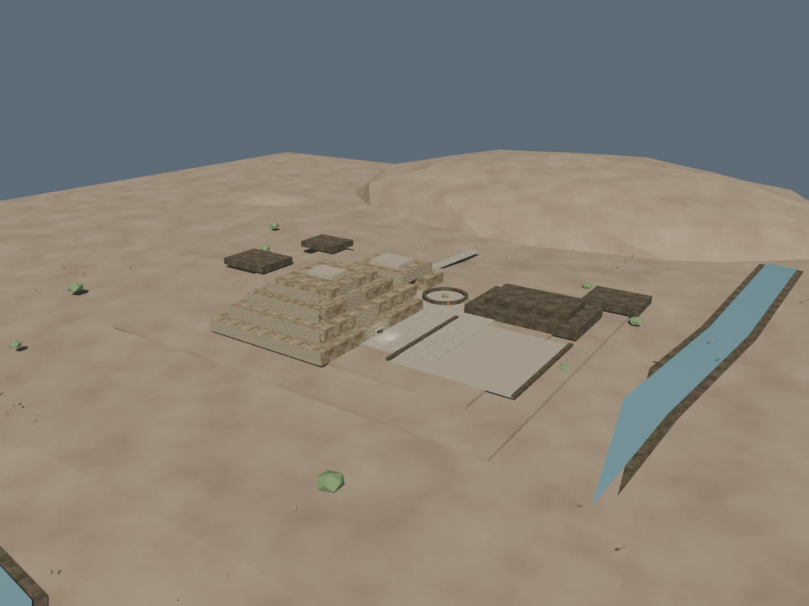
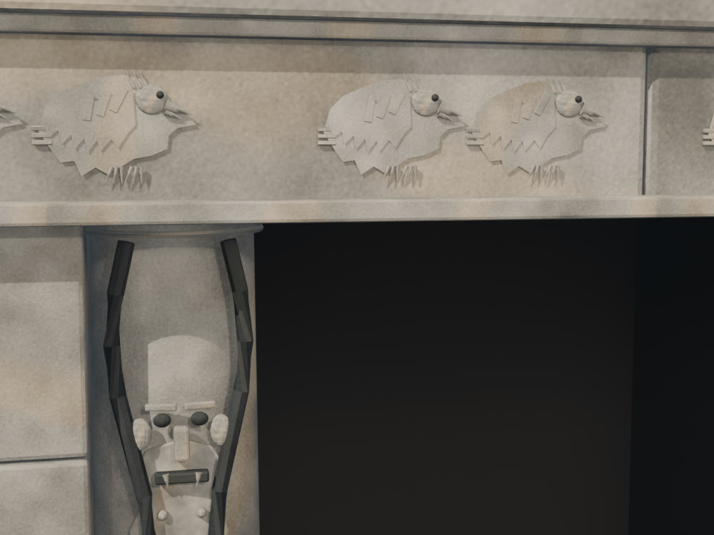
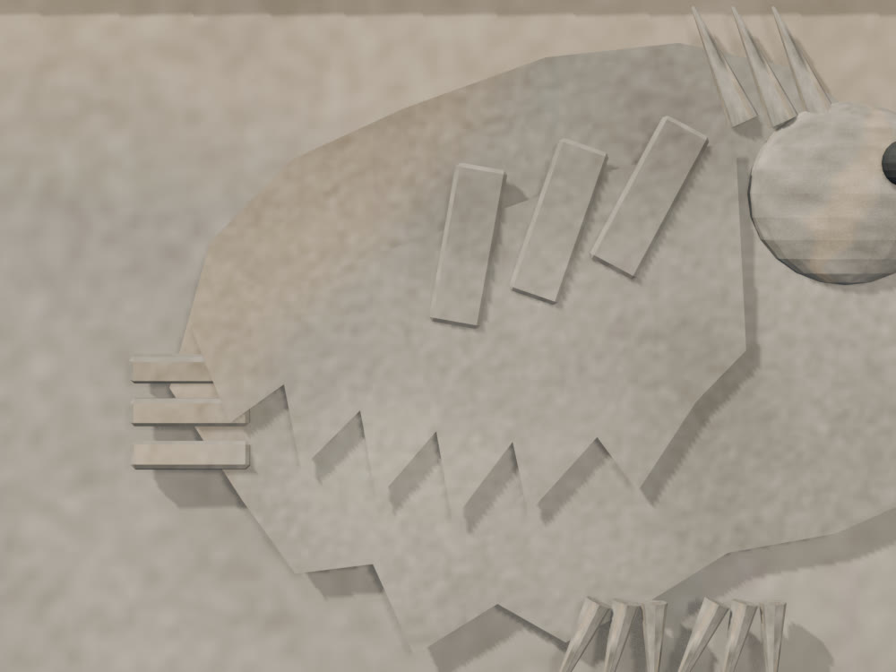
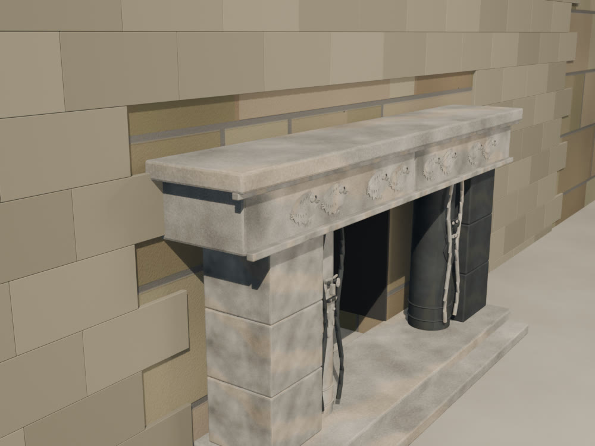
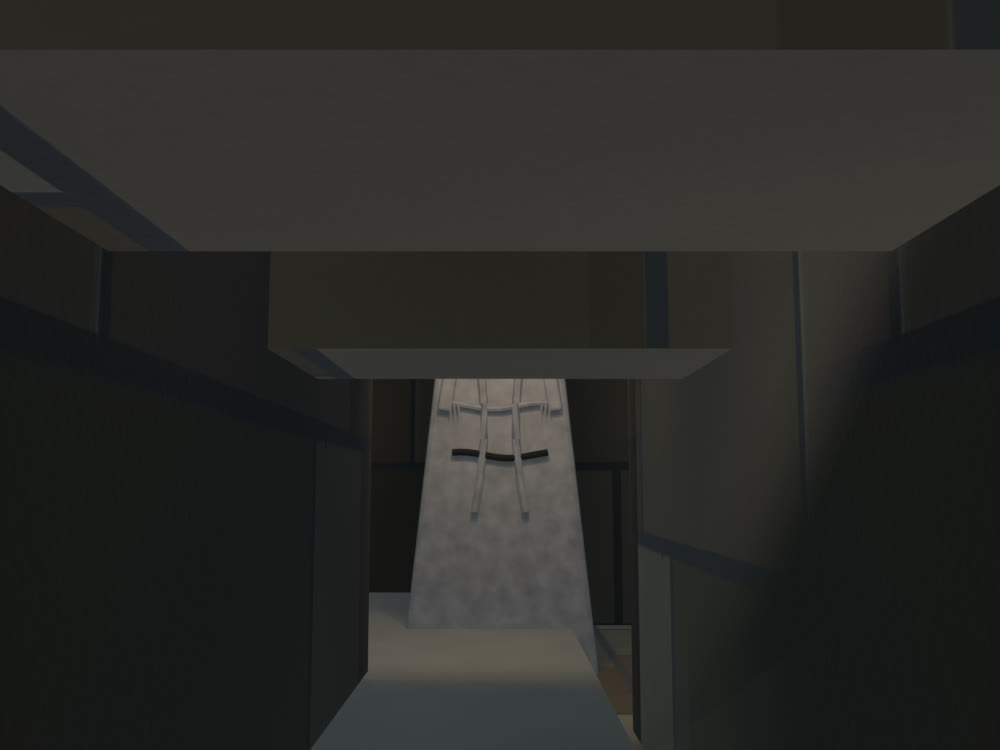
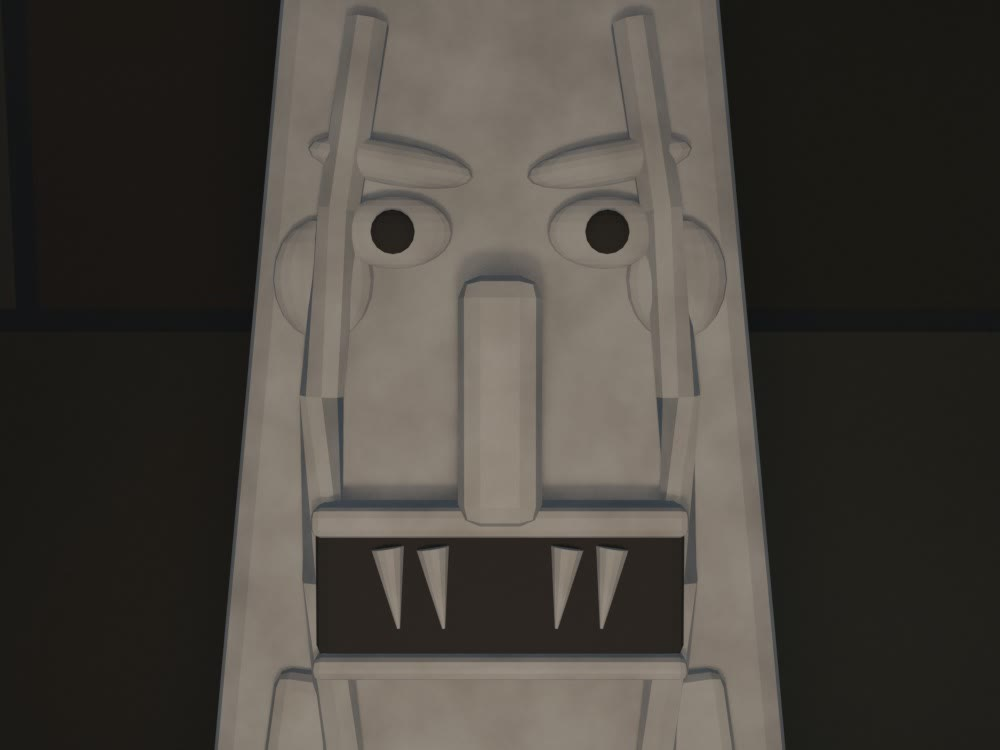

# Chavín — pase high-poly v0.1

Fecha: 27 de octubre de 2026.
Estado: **aceptado como base de detalle para el preview; no es una reconstrucción final**.
Fuente: `blender/chavin/chavin_highpoly_v0.1.blend` (10,0 MB), generada desde `chavin_portada_v0.1.blend`.
Generador: `scripts/build_chavin_highpoly.py`.
Derivados: `chavin_lod0.blend` y `chavin_lod1.blend`, regenerados con `scripts/build_chavin_lod.py` y exportados con `scripts/export_chavin_lod.py`.

## Vistas

### Conjunto

### Portada de las Falcónidas

### Friso y falcónidas

### Fachada este y mampostería

### Galería del Lanzón

### Frente tallado del Lanzón

## Qué cambió

- Se añadieron **bloques de mampostería en relieve** en las cuatro terrazas del frontis este del Edificio A y en los frentes secundarios. Son 4.152 bloques, 107.932 tris, con juntas de 4 mm y tres tonos de piedra.
- Se reemplazó el material de estos bloques por `MAT-Chavin_Ashlar_HP_A/B/C`: piedra lisa sin el patrón de hiladas pintado de la textura 2K, que a corta distancia producía un efecto de azulejo.
- Se talló el **frente del Lanzón** con ojos, pupilas, cejas, orejas, nariz, boca, labios, colmillos, cabello-serpiente, bandas, brazos y garras (5.240 tris). Es una lectura geométrica, no una reproducción iconográfica.
- Se añadieron detalles al friso y las jambas de la Portada, y una luz de relleno para las cámaras de revisión.
- Se subdividieron y desplazaron las lomas (Cochas y cuatro lomas perimetrales) y se añadieron 246 rocas en los bordes del valle.
- Se añadieron cámaras de QA para Portada, friso, Lanzón y fachada. No forman parte del recorrido público.
- Se regeneraron LOD0 y LOD1 desde esta fuente; se actualizaron GLB, hashes, registro de assets y caché del service worker.

## Métricas

| Métrica | LOD0 | LOD1 |
|---|---:|---:|
| Triángulos | 174.582 | 18.738 |
| GLB | 1.846.904 B | 751.384 B |
| Mallas exportadas | 4 | 4 |
| Draw calls en la vista inicial | 20 | 15 |
| Texturas decodificadas estimadas | 133,3 MB | 69,3 MB |
| Materiales | 15 | 11 |

- El LOD0 entra en el presupuesto de producción de 150.000–250.000 tris; el LOD1 queda en 18.738 tris.
- El LOD1 omite los detalles marcados con `lod1_exclude`: bloques de fachada, talla del Lanzón y detalles de la Portada.
- La mampostería de fachada concentra 107.932 tris del LOD0; el Lanzón tallado, 5.240.
- El visor usa `minDistance: 0.08` para permitir acercamientos de inspección; el plano cercano de la cámara sigue en 0,5 unidades de escena.

## Evidencia e inferencia

**Documentado o reportado:**

- La Portada se abre en el frontis este del Edificio A, con dos columnas talladas, jambas trilíticas y un friso partido con aves.
- El Lanzón es un monolito ahusado de unos 4,5 m con una figura antropomorfa tallada.
- El Edificio A se organiza en terrazas escalonadas y mampostería de bloques labrados.

**Inferido en este pase:**

- Dimensiones y despiece de los bloques de fachada; las hiladas son regulares y no reproducen el aparejo exacto.
- Profundidad del relieve, juntas y variación tonal de la piedra.
- Ubicación y escala de las rocas del valle y de las lomas desplazadas.

**Interpretativo:**

- La talla del Lanzón es una lectura volumétrica y estilizada; los ojos, colmillos y serpentinas no reconstruyen el grabado original.
- Los relieves de la Portada siguen siendo perfiles geométricos, ahora con mayor detalle.
- La mampostería de fachada es un telón de relieve, no un levantamiento pieza a pieza.

## QA ejecutado

- `npm run validate`: OK (4 ciudades, 2 disponibles).
- `npm run build`: OK.
- `npm run bench -- --city chavin --qa`: OK; 20 draw calls en LOD0, 15 en LOD1, sin errores de consola.
- Recorrido de seis paradas verificado en escritorio y móvil emulado.
- LOD1 seleccionado en móvil; sin fallback v1 independiente.
- Los FPS de SwiftShader no representan hardware real y no se usan como certificación.

## Límites

- El frente tallado del Lanzón se revisa con la cámara de QA; en el recorrido público se ve desde el corredor, donde la pieza queda en penumbra y el detalle se lee como silueta.
- El interior de la galería no tiene iluminación propia en el visor; un acercamiento frontal requeriría bajar el plano cercano y añadir una luz de galería.
- Los bloques de fachada son un relieve aplicado sobre la fachada existente; en las juntas y bordes de terraza todavía se ve la textura de la pared base.
- El terreno sigue siendo procedural; las lomas y rocas no son topografía levantada.
- No se copiaron imágenes oficiales ni se usaron texturas de IA.
- Este pase no debe presentarse como remaster v2 ni como reconstrucción final.
