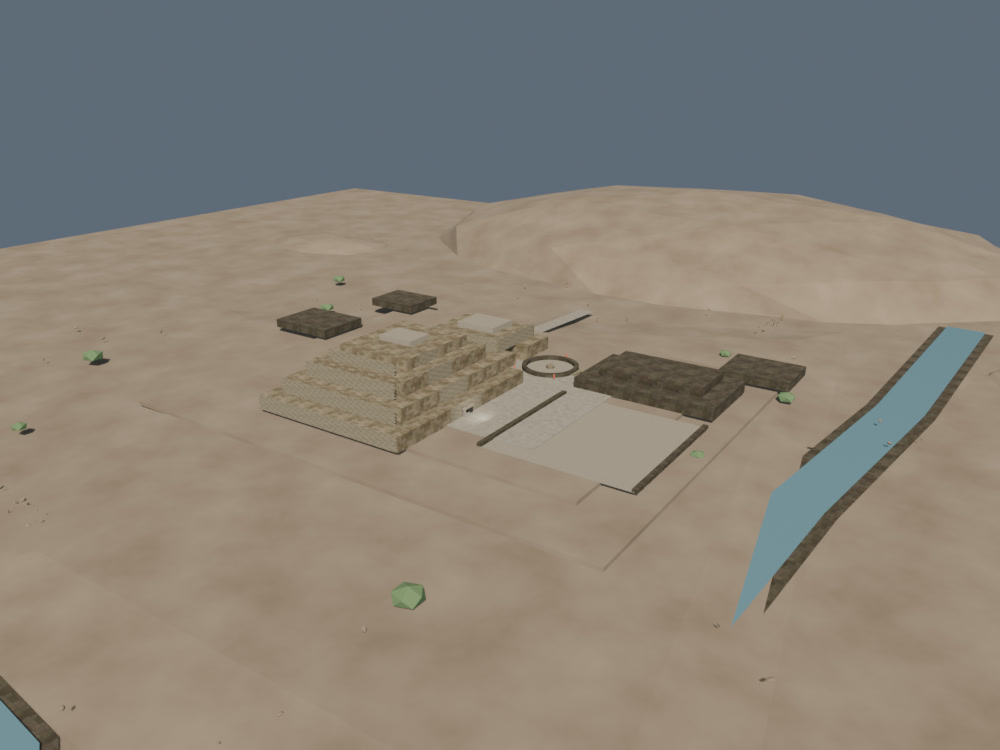
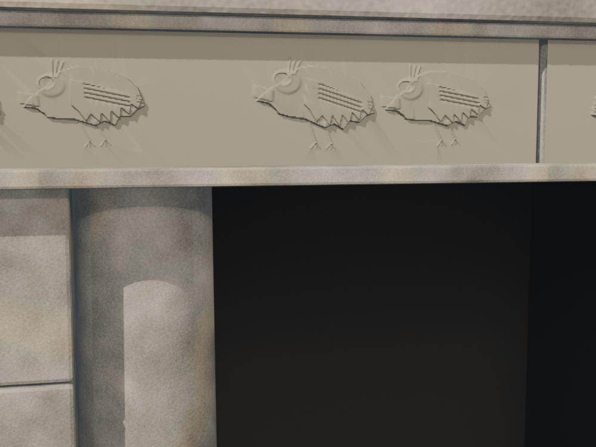
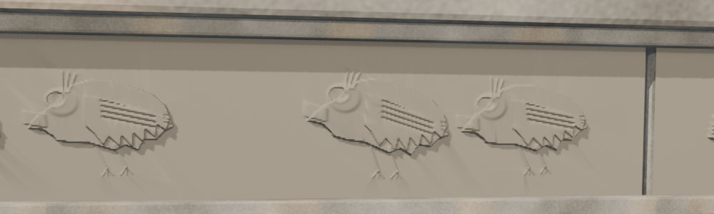
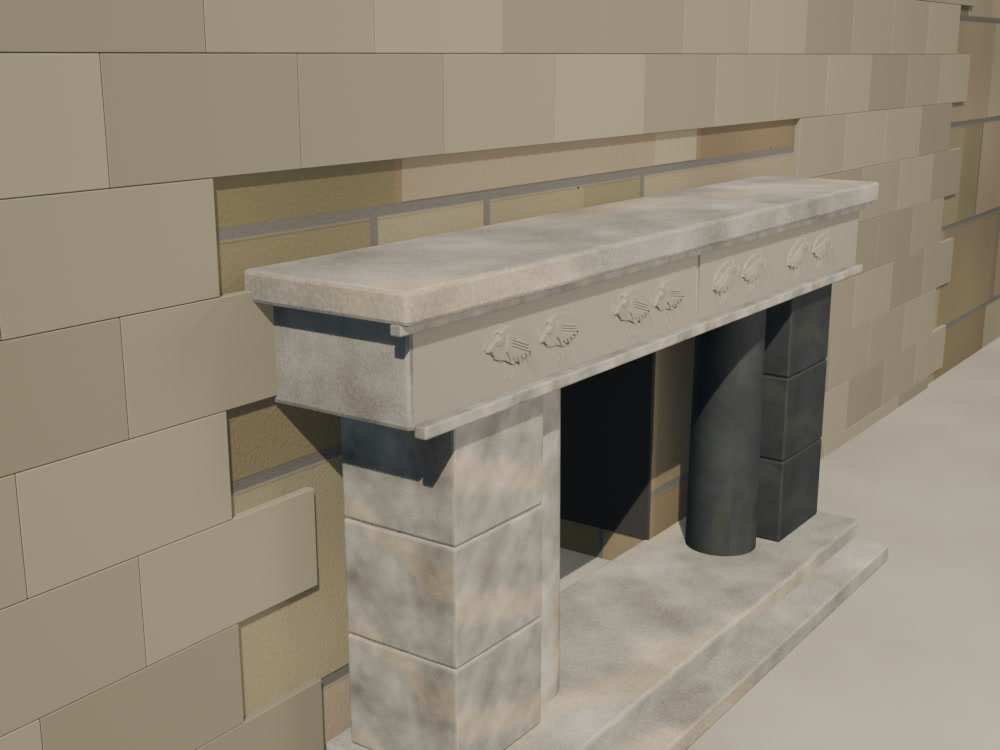
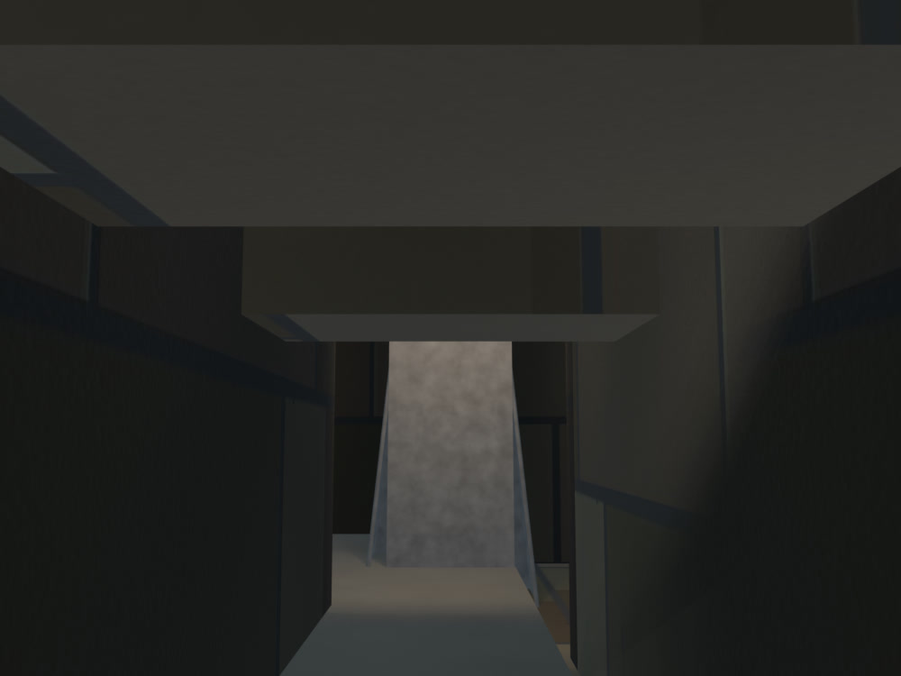
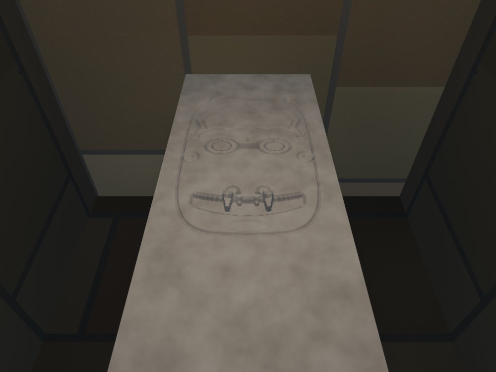

# Chavín — pase high-poly v0.2

Fecha: 28 de octubre de 2026.
Estado: **superado por `highpoly-v0.3.md`; se conserva como registro del pase anterior**.
Fuente: `blender/chavin/chavin_highpoly_v0.2.blend` (11,7 MB), derivada de `chavin_highpoly_v0.1.blend`.
Generadores: `scripts/build_chavin_highpoly.py` y `scripts/build_chavin_relief_v0_2.py`.
Derivados: `chavin_lod0.blend` / `chavin_lod1.blend`, regenerados con `scripts/build_chavin_lod.py` y exportados con `scripts/export_chavin_lod.py`.

## Vistas

### Conjunto

### Portada de las Falcónidas

### Friso integrado

### Fachada este

### Galería del Lanzón

### Rostro inciso del Lanzón

## Qué cambió respecto de v0.1

- **Friso de la Portada:** se retiraron las ocho placas planas con ojos esféricos, picos y garras de cono. En su lugar hay dos paneles de relieve integrados con cuatro aves cada uno, alas con plumas incididas, ojos calados, picos, crestas y patas en el mismo plano de piedra.
- **Lanzón:** se retiraron la nariz de caja, los colmillos de cono, los ojos elipsoidales y el cabello de tubos. El frente se reconstruyó como una superficie de altura continua y se sustituyó la cara frontal del monolito para que las incisiones negativas no quedaran ocultas.
- **Lectura incisa:** el rostro se resolvió con líneas y planos de baja profundidad: ojos concéntricos, cejas onduladas, nariz roma, boca ancha con dos colmillos, orejeras y serpientes laterales. Es una lectura gráfica, no una copia del relieve original.
- **Columnas:** se retiraron las caras y serpientes superpuestas. Quedan como cilindros limpios hasta un pase específico de columnas.
- **Frente del Lanzón:** se eliminó la cara frontal del monolito base y se conserva una copia lisa para LOD1. Así el LOD0 usa el frente tallado y el LOD1 mantiene la silueta simple.
- **Recorrido:** `minDistance` sube de 0,08 a 0,18 para mirar la Portada y el Lanzón desde una distancia donde el relieve se lee; el acercamiento extremo deja de ser la vista principal.
- **Luz de galería:** se añadió `city.lights` al visor y una luz puntual cálida en la Galería del Lanzón para revelar la incisión sin lavar el resto del recinto.

## Métricas

| Métrica | LOD0 | LOD1 |
|---|---:|---:|
| Triángulos | 235.098 | 14.902 |
| GLB | 1.814.248 B | 713.952 B |
| Mallas exportadas | 4 | 4 |
| Draw calls en la vista inicial | 19 | 14 |
| Texturas decodificadas estimadas | 133,3 MB | 69,3 MB |
| Materiales | 15 | 11 |

- El LOD0 sigue dentro del presupuesto de 150.000–250.000 tris.
- El LOD1 omite el relieve del friso, el frente inciso y la mampostería de fachada; conserva el monolito liso.
- El friso integrado y el rostro inciso sustituyen los detalles high-poly de v0.1.

## Evidencia e inferencia

**Documentado o reportado:**

- La Portada se abre en el frontis este del Edificio A, con dos columnas, jambas trilíticas y un friso partido con aves.
- El Lanzón es un monolito ahusado de unos 4,5 m con una figura antropomorfa, boca felina, colmillos y serpientes.
- El rostro tallado ocupa aproximadamente un tercio superior de la pieza.

**Inferido en este pase:**

- Profundidad del friso, ancho de las plumas y separación de las aves.
- Trazado, proporción y profundidad de las incisiones del Lanzón.
- Copia lisa del monolito para LOD1 a partir de la silueta existente.

**Interpretativo:**

- El rostro del Lanzón es una lectura incisa y estilizada; no reproduce el relieve original ni sus proporciones exactas.
- Las aves del friso son perfiles geométricos con plumas y ojos tallados; no son un calco iconográfico.
- Las columnas quedan limpias; su talla se resolverá en un pase dedicado.

## QA ejecutado

- `npm run validate`: OK (4 ciudades, 2 disponibles).
- `npm run build`: OK.
- `npm run bench -- --city chavin --qa`: 19 draw calls en LOD0, 14 en LOD1, seis paradas y sin errores de consola.
- LOD1 seleccionado en móvil emulado.
- Los FPS de SwiftShader no representan hardware real y no se usan como certificación.

## Límites

- El rostro del Lanzón se lee como una incisión gráfica a distancia de recorrido; en primer plano no alcanza la calidad de un relieve esculpido.
- El interior de la galería no tiene luz propia en el visor; un primer plano frontal requeriría un pase de iluminación y un modelo esculpido con mapa normal/AO.
- El friso está pensado para 3–5 m; a menos de 2 m se notan las facetas del relieve.
- Las columnas quedan sin talla figurativa en esta versión.
- No se copiaron imágenes oficiales ni se usaron texturas de IA.
- Este pase no debe presentarse como remaster v2 ni como reconstrucción final.
