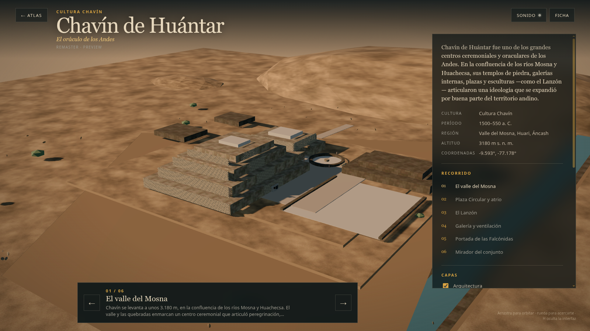
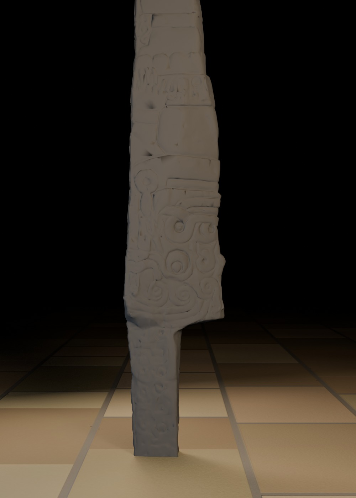
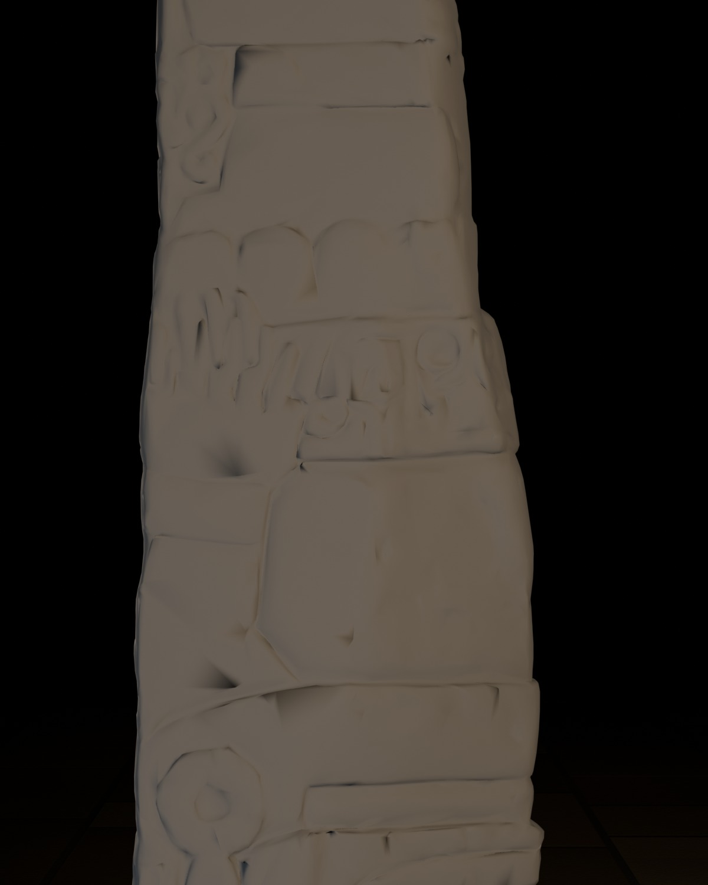
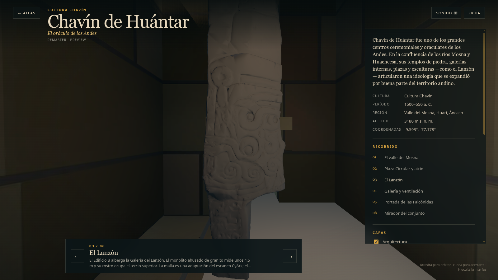

# Chavín — pase high-poly v0.3: Lanzón escaneado

Fecha: 28 de octubre de 2026.
Estado: **pase correctivo del Lanzón; preview controlado, no reconstrucción final**.
Fuente: `blender/chavin/chavin_highpoly_v0.3.blend` (13,1 MB), derivada de la escena v0.2.
Generador del Lanzón: `scripts/build_chavin_lanzon_scan_v0_3.py`.
Derivados: LOD0/LOD1 regenerados con `scripts/build_chavin_lod.py` y `scripts/export_chavin_lod.py`.

## Vistas

### Conjunto en el visor

### Galería y Lanzón

### Detalle del relieve

### Parada 3 del recorrido

## Qué cambió respecto de v0.2

- **Lanzón:** se retiró el rostro inciso construido en v0.2 (`GEO-Chavin_Lanzon_HP_FaceRelief`) y se sustituyó por una malla derivada del escaneo 3D de CyArk / Google Arts & Culture. La silueta, la inclinación, el relieve y las proporciones provienen del escaneo, no de una interpretación gráfica.
- **Escala y colocación:** 4,5 m de alto, base en `z=3.0` y centro en `y=62`; caja final `0,502 × 0,972 × 4,5 m` (la profundidad incluye el relieve). El modelo se reorientó para que el frente mire hacia la cámara del recorrido (`-X` del visor).
- **Geometría:** se eliminó la placa de montaje del escaneo, se repararon normales y agujeros y se decimó a 50.000 triángulos. La textura fotográfica del escaneo **no se reutiliza**; el material es un granito oscuro procedural propio (`MAT-Chavin_Lanzon_Scan`, base 0,085 / rugosidad 0,93).
- **LOD1:** en lugar del monolito liso de 298 triángulos, incluye una copia decimada a 12.000 triángulos con el mismo material. Así el rostro y el relieve siguen existiendo en móvil, a costa de ~12.000 triángulos.
- **Visor:** `near` baja de 0,5 a 0,05 para permitir el primer plano; la parada 3 usa una cámara interior a 0,15 m del frente, fov 80, `minDistance: 0,1` y dos luces puntuales cálida/fría globales de baja intensidad en la galería.
- **Caché:** `ciudades-sagradas-v20`.

## Licencia y atribución

- El escaneo original y esta geometría derivada son **CC BY-NC-SA 4.0**.
- Atribución: «Lanzón de Chavín, escaneo 3D de CyArk / Google Arts & Culture; adaptación geométrica del proyecto Ciudades Sagradas».
- El GLB original **no se versiona**. Solo se publican la malla decimada/reparada y los renders.
- El uso comercial de estos derivados no está permitido por la licencia; el código sigue en MIT.
- Detalle completo en [`LICENSE-ASSETS.md`](../../../LICENSE-ASSETS.md) y en `docs/fuentes/registro-assets.csv`.

## Métricas

| Métrica | LOD0 | LOD1 |
|---|---:|---:|
| Triángulos | 249.266 | 26.898 |
| GLB | 1.960.828 B | 785.260 B |
| Mallas exportadas | 4 | 4 |
| Draw calls en la vista inicial | 19 | 15 |
| Texturas decodificadas estimadas | 133,3 MB | 69,3 MB |
| Lanzón | 50.000 tris | 12.000 tris |

- LOD0 sigue dentro del presupuesto de 150.000–250.000 tris.
- LOD1 sube de 14.902 a 26.898 tris para conservar el relieve del Lanzón.
- El bench de SwiftShader no certifica FPS; solo detecta regresiones y errores.

## Evidencia e inferencia

**Documentado o reportado:**

- El Lanzón es un monolito de granito de ~4,5 m con figura antropomorfa, boca felina, colmillos y serpientes.
- El rostro ocupa el tercio superior; el cuerpo está cubierto de relieves.
- El escaneo de CyArk/Google Arts & Culture registra la pieza y su relieve.

**Derivado del escaneo:**

- Silueta, inclinación, profundidad del relieve y proporciones del monolito.
- Posición del rostro y de los motivos laterales.

**Interpretativo o pendiente:**

- El material granítico oscuro es una elección de look-dev, no una muestra de color medida.
- La decimación a 50.000/12.000 tris suaviza incisiones finas; no se horneó normal/AO porque el bake produjo artefactos por UVs y geometría no manifiesta.
- La cámara de la parada 3 está limitada por el ancho de la galería: el primer plano recorta la cresta superior y prioriza el relieve central.

## QA ejecutado

- `npm run validate`: OK.
- `npm run build`: OK.
- Bench completo LOD0/LOD1/móvil/offline: OK; LOD0 19 draw calls, LOD1 15, móvil en LOD1, sin fallback v1 y offline con LOD0.
- Revisión visual: el Lanzón conserva relieve y silueta en LOD0; LOD1 mantiene una lectura del relieve.
- Sin texturas de IA y sin la textura fotográfica del escaneo en los GLB.

## Límites

- El bake de normal/AO desde el escaneo **no es usable**: los UVs del escaneo se solapan y la malla tiene bordes no manifiestos; los intentos generaron artefactos de diamante. Se optó por geometría decimada y material plano.
- La licencia CC BY-NC-SA 4.0 impide uso comercial de los derivados del Lanzón.
- El primer plano del rostro depende de la orientación y de la luz; la galería es estrecha y el encuadre no puede abrirse más sin atravesar muros.
- El escaneo no es un levantamiento métrico certificado; su escala se normalizó a 4,5 m.
- Este pase no debe presentarse como remaster v2 ni como reconstrucción final.
