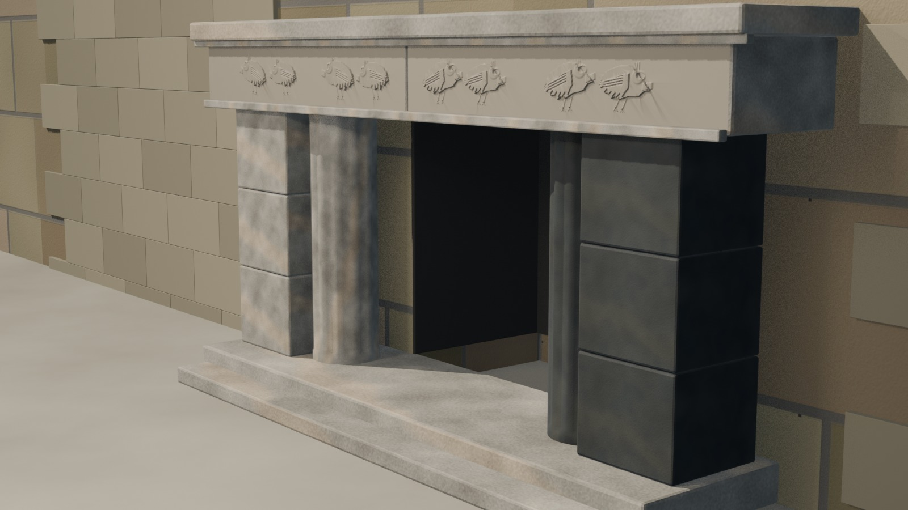
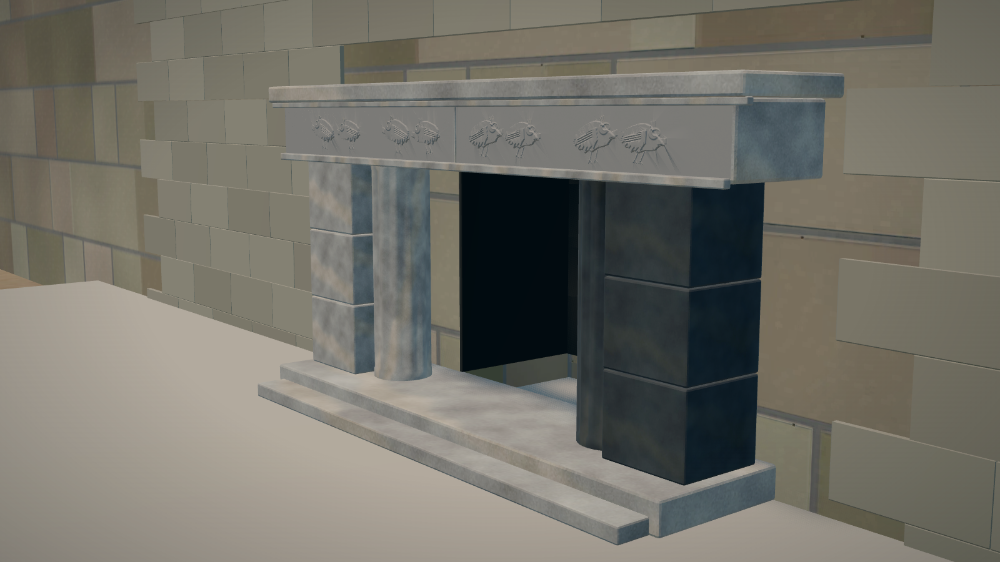

# Chavín — pase high-poly v0.4: Portada legible y fustes acanalados

Fecha: 28 de octubre de 2026.
Estado: **corrección de la Portada; preview controlado, no reconstrucción final**.
Fuente: `blender/chavin/chavin_highpoly_v0.4.blend` (13.378.012 B), derivada de v0.3.
Generador de columnas: `scripts/build_chavin_portada_columns.py`.
Derivados: LOD0/LOD1 regenerados con `scripts/build_chavin_lod.py` y `scripts/export_chavin_lod.py`.

## Qué se corrigió

- **La causa del encuadre:** el LOD0 sí contenía las columnas. El problema era la cámara de la parada 5: usaba `fov 46`, mucho más abierto que el objetivo de 52 mm de la cámara fuente. Se mantuvo la posición 3/4 de la fuente y se ajustó el `fov` a **28**, con lo que las columnas y el friso recuperan presencia.
- **Columnas:** se sustituyeron los cilindros lisos de 252 tris por fustes de **572 tris**, 12 acanaladuras verticales suaves, radio 0,31 m y altura 2,30 m. Se conservan ubicación, diámetro y materiales claro/oscuro de la Portada.
- **Lectura:** las acanaladuras son una **lectura geométrica interpretativa** del fuste tallado, no un calco de la iconografía ni del escaneo. El texto de la parada ya advierte que las tallas son una lectura geométrica.
- **Sin cambios** en Lanzón, friso, jambas, terreno, luces ni en el resto del recorrido.

## Vistas

### Portada desde la cámara fuente 3/4



### Parada 5 en el visor



## Métricas

| Métrica | LOD0 | LOD1 |
|---|---:|---:|
| Triángulos | 249.906 | 27.539 |
| GLB | 1.962.060 B | 786.136 B |
| Mallas exportadas | 4 | 4 |
| Draw calls en la vista inicial | 19 | 15 |
| Texturas decodificadas estimadas | 133,3 MB | 69,3 MB |
| Lanzón | 50.000 tris | 12.000 tris |
| Columnas | 2 × 572 tris | 2 × 572 tris |

- LOD0 queda **dentro del techo nominal de 250.000**; es el coste de las dos columnas talladas y se acepta para este preview.
- LOD1 sube de 26.898 a 27.539 tris; el resto de la malla móvil no cambia.
- El bench de SwiftShader no certifica FPS; solo detecta regresiones y errores.

## Evidencia e inferencia

**Documentado o reportado:**

- La Portada se abre en el frontis este del Edificio A, con dos columnas circulares de 2,30 m y 0,61–0,62 m de diámetro, jambas trilíticas y friso partido.
- El sector sur se asocia a granito blanco y el norte a caliza negra; las columnas representan seres antropomorfos masculino y femenino.

**Inferido o interpretativo:**

- Las acanaladuras verticales no están documentadas pieza a pieza; son una lectura geométrica para que el fuste se lea como piedra tallada en el visor.
- La cámara de la parada 5 conserva la posición 3/4 de la fuente, pero el `fov` se ajusta para el encuadre web y no reproduce exactamente el objetivo de 52 mm.

## QA ejecutado

- `npm run validate`: OK.
- `npm run build`: OK.
- Bench LOD0/LOD1/móvil/offline: OK; LOD0 19 draw calls, LOD1 15, móvil en LOD1, sin errores de consola.
- Parada 5 revisada en LOD0 con la UI oculta: ambas columnas y el friso quedan visibles; la captura se tomó en horario de mediodía para revisar las acanaladuras.
- Sin texturas de IA ni textura fotográfica del escaneo en los GLB.

## Reproducir

```bash
blender --background blender/chavin/chavin_highpoly_v0.3.blend \
  --python scripts/build_chavin_portada_columns.py -- \
  --out-blend blender/chavin/chavin_highpoly_v0.4.blend

blender --background blender/chavin/chavin_highpoly_v0.4.blend \
  --python scripts/build_chavin_lod.py -- --lod 0 \
  --out-blend blender/chavin/chavin_lod0.blend

blender --background blender/chavin/chavin_highpoly_v0.4.blend \
  --python scripts/build_chavin_lod.py -- --lod 1 \
  --out-blend blender/chavin/chavin_lod1.blend

blender --background blender/chavin/chavin_lod0.blend \
  --python scripts/export_chavin_lod.py -- \
  --out public/cities/chavin/model_lod0.glb

blender --background blender/chavin/chavin_lod1.blend \
  --python scripts/export_chavin_lod.py -- \
  --out public/cities/chavin/model_lod1.glb --max-texture-size 1024

npm run validate
npm run build
```

## Límites

- Las columnas siguen siendo una reconstrucción artística; no hay un levantamiento de las acanaladuras.
- La licencia CC BY-NC-SA 4.0 del Lanzón sigue limitando el uso comercial.
- No hay QA nueva en Android para v0.4; la aprobación Android registrada corresponde a v0.3.
