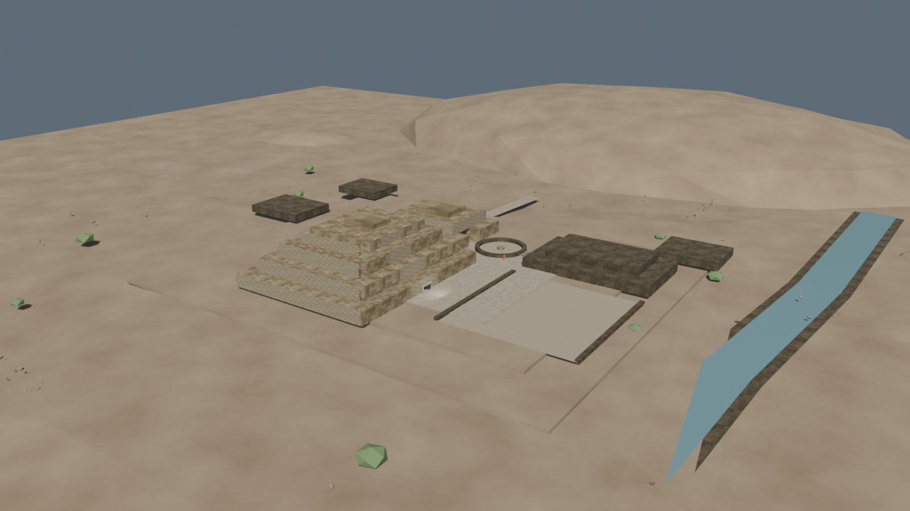
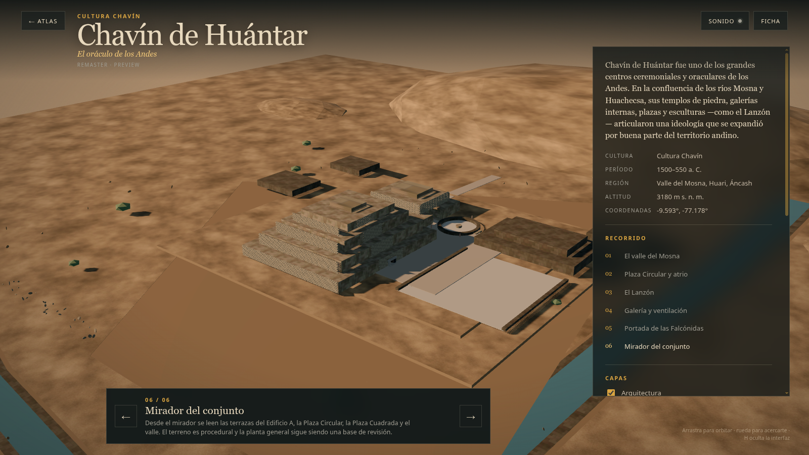

# Chavín — pase high-poly v0.5: remates de cima integrados

Fecha: 29 de octubre de 2026.
Estado: **corrección visual; preview controlado, no reconstrucción final**.
Fuente: `blender/chavin/chavin_highpoly_v0.5.blend`, derivada de v0.4.
Registro de la corrección: `blender/chavin/chavin_portada_v0.2.blend`.
Derivados: LOD0/LOD1 regenerados con `scripts/build_chavin_lod.py` y `scripts/export_chavin_lod.py`.

## Qué se corrigió

- `GEO-Chavin_EdificioA_Summit` y `GEO-Chavin_EdificioB_Summit` dejaron de ser cajas de plaster blanco.
- Ambos remates usan `MAT-Chavin_Stone_Tiled`, se hundieron 0,02 m en su terraza y recibieron una basa perimetral de piedra.
- El remate A conserva la altura documentada de 2 m; el B sigue como volumen inferido.
- No se añadieron techos, recintos ni alturas no conservadas.

## Métricas

| Métrica | LOD0 | LOD1 |
|---|---:|---:|
| Triángulos | 249.930 | 27.563 |
| GLB | 1.962.280 B | 786.356 B |
| Mallas exportadas | 4 | 4 |
| Draw calls en la vista inicial | 18 | 15 |
| Texturas decodificadas estimadas | 133,3 MB | 69,3 MB |

- LOD0 queda 70 tris por debajo del techo nominal de 250.000.
- El LOD1 conserva el Lanzón de 12.000 tris y añade solo la basa de los remates.

## Vistas

## QA ejecutado

- `npm run validate`: OK.
- `npm run build`: OK.
- `npm run bench -- --city chavin --qa`: OK; 18/15 draw calls; sin errores de consola.
- Hero, mirador, Plaza Circular y móvil revisados: no quedan bloques blancos suspendidos.

## Límites

- Los remates siguen siendo una lectura de blockout; no son un levantamiento de los recintos de cima.
- El terreno es procedural y la Portada conserva relieves interpretativos.
- Sin QA en hardware real para v0.5.
- El Lanzón mantiene la licencia CC BY-NC-SA 4.0.
