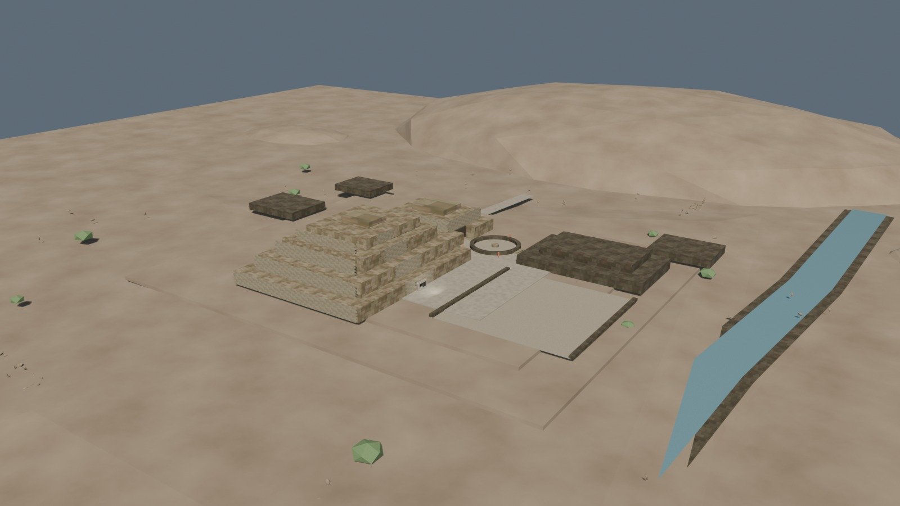
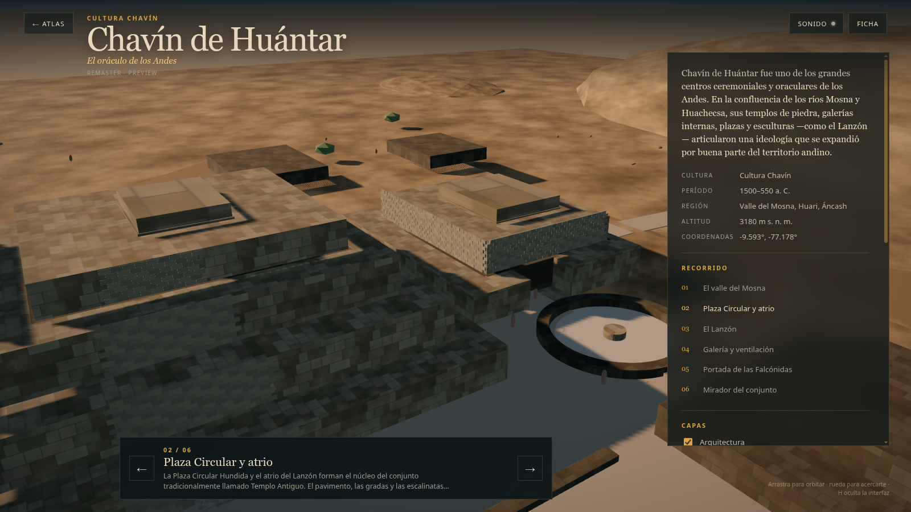

# Chavín — pase high-poly v0.6: apoyos de terrazas

Fecha: 29 de octubre de 2026.
Estado: **corrección de lectura; preview controlado, no reconstrucción final**.
Fuente: `blender/chavin/chavin_highpoly_v0.6.blend`, derivada de v0.5.
Generador: `scripts/add_chavin_tier_supports.py`.
Derivados: LOD0/LOD1 regenerados con `scripts/build_chavin_lod.py` y `scripts/export_chavin_lod.py`.

## Qué se corrigió

- `EdificioA_Tier_04` tenía un vacío de 6 m bajo su centro; se rellenó desde Tier_03 (z 15) hasta su base (z 21), con una basa que sobresale 0,4 m.
- `EdificioB_Tier_02` tenía un vacío de 6 m; se añadieron muros perimetrales de apoyo desde z 3 hasta z 9, dejando libre la galería central.
- No se eliminaron terrazas, remates ni galerías documentadas.
- Los apoyos usan piedra oscura para leerse como fundación, no como una caja más.

## Métricas

| Métrica | LOD0 | LOD1 |
|---|---:|---:|
| Triángulos | 249.990 | 27.623 |
| GLB | 1.962.740 B | 786.816 B |
| Mallas exportadas | 4 | 4 |
| Draw calls en la vista inicial | 18 | 15 |
| Texturas decodificadas estimadas | 133,3 MB | 69,3 MB |

- LOD0 queda 10 tris por debajo del techo nominal de 250.000.
- Los remates A/B se conservan; A mantiene su altura documentada de 2 m y B sigue como volumen inferido.

## Vistas

## QA ejecutado

- `npm run validate`: OK.
- `npm run build`: OK.
- `npm run bench -- --city chavin --qa`: OK; 18/15 draw calls; sin errores de consola.
- Core, Plaza Circular y móvil revisados: los bloques ya muestran apoyo visible.

## Límites

- Los apoyos son una solución de lectura de blockout, no un levantamiento estructural.
- No hay QA en hardware real para v0.6.
- El Lanzón mantiene la licencia CC BY-NC-SA 4.0.
