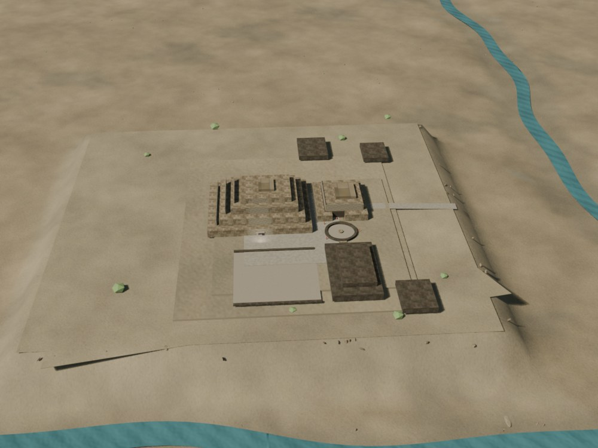
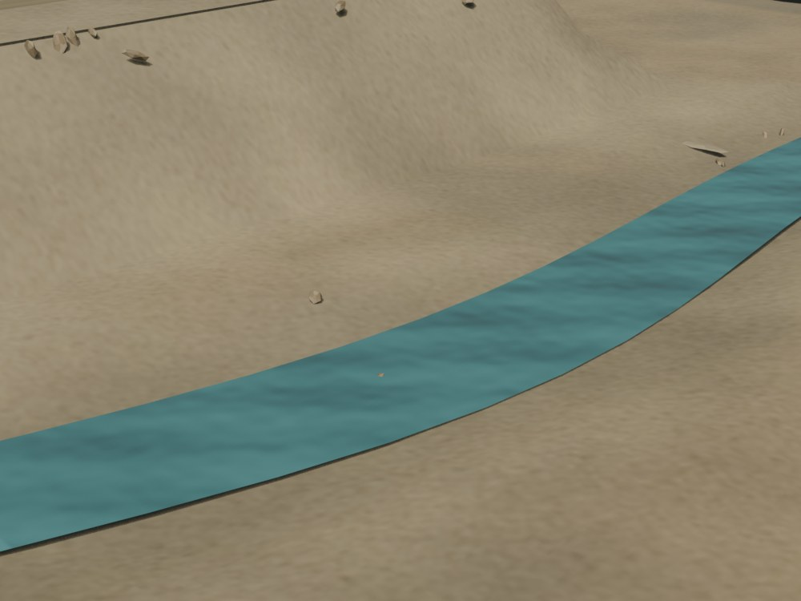
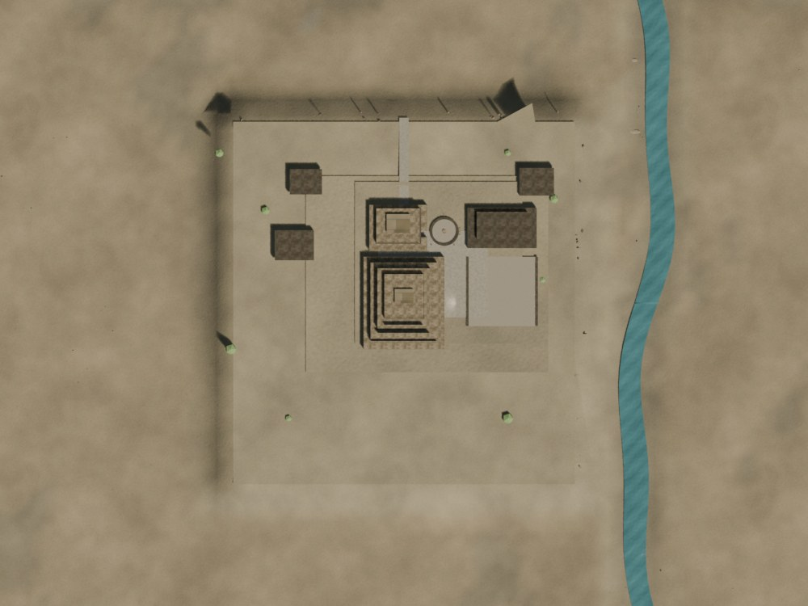

# Chavín — pase de valle v0.7

Fecha: 31 de octubre de 2026.
Estado: **preview controlado; no es reconstrucción final ni topografía levantada**.
Fuente: `blender/chavin/chavin_highpoly_v0.7.blend`, derivada de v0.6.
Generadores: `scripts/build_chavin_valley_v0_7.py`, `scripts/make_chavin_terrain_materials_v2.py`.
Derivados: LOD0/LOD1 regenerados con `scripts/build_chavin_lod.py` y `scripts/export_chavin_lod.py`.

## Qué cambió

- Se reemplazó la planicie de 900×900 m por un valle procedural de 1300×1300 m.
- El **Mosna** queda al este, con el agua unos **29,5 m por debajo** de la superficie del sitio; el Plan de Manejo 2020 documenta ~30 m.
- El **Wacheqsa** se movió al norte/noroeste y la confluencia al noreste; antes estaba modelado al sur.
- Se añadieron bancos, terrazas aluviales, laderas, un anillo de crestas y un plano lejano con niebla.
- Se sustituyeron los 210 cantos de río por 110 cantos, 28 bloques de borde, 34 bloques de ladera y 7 barras de grava.
- Se añadieron 138 arbustos y 190 matas de pasto altoandino; no hay árboles inventados.
- Se añadió una capa de superficie del sitio con variación de tierra, sin convertir la explanada en césped.
- Se corrigieron las cámaras de la parada 1 y del hero para leer el río y el desnivel.
- No se modificaron arquitectura, galerías, Portada ni Lanzón.

## Evidencia

**Documentado/verificado:**

- El Mosna corre unos 30 m por debajo del Edificio A (Plan de Manejo 2020).
- El sitio se organiza mirando al este.
- La confluencia Mosna/Wacheqsa y la posición relativa de los ríos se cotejaron con el plano y OpenStreetMap; no se incorporó cartografía.

**Inferido/procedural:**

- Trazado fino, meandros, anchos, bancos y pendientes.
- Alturas de las crestas, cobertura vegetal y materiales.
- La explanada, terrazas y taludes siguen siendo una base de revisión.

No se usó DEM. El terreno no debe citarse como topografía levantada.

## Métricas

| Métrica | LOD0 | LOD1 |
|---|---:|---:|
| Triángulos | 249.830 | 42.951 |
| GLB | 1.736.128 B | 744.652 B |
| Mallas exportadas | 4 | 4 |
| Draw calls en la vista inicial | 19 | 16 |
| Texturas decodificadas estimadas | 134,7 MB | 70,7 MB |
| Imágenes | 14 | 14 |

- LOD0 queda 170 tris por debajo del techo nominal de 250.000.
- LOD1 queda por debajo del objetivo de 45.000.
- El agua usa material opaco en el visor para evitar el coste de transparencia.

## Vistas

## QA

- `npm run validate`: OK.
- `npm run build`: OK.
- `npm run bench -- --city chavin --qa`: LOD0 19 calls / 249.830 tris; LOD1 16 calls / 42.950 tris; sin errores de consola.
- Desktop real Intel RPL-S, Chrome 139/Linux, 1600×900:
  - LOD0: 60,0 fps, 19 calls, carga 1,69 s.
  - LOD1: 60,0 fps, 16 calls, carga 0,39 s.
  - 0 errores de consola.
- Resultados: `docs/qa/resultados/chavin-v07-desktop-2026-10-31/`.
- Móvil real, 1080p real y kiosco siguen pendientes.

## Límites

- El terreno es procedural; no reemplaza un DEM ni un levantamiento.
- Los ríos y las crestas son una lectura de escala y posición, no hidrología ni topografía.
- El agua es una superficie simplificada, sin simulación ni caudal.
- La vegetación es low-poly y no representa un inventario botánico.
- La explanada sigue siendo una base de blockout; no se inventaron muros perimetrales ni terrazas agrícolas.
- No hay QA en móvil físico ni certificación de 1080p.
- El Lanzón mantiene la licencia CC BY-NC-SA 4.0.
