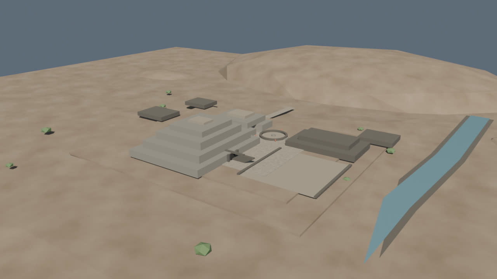
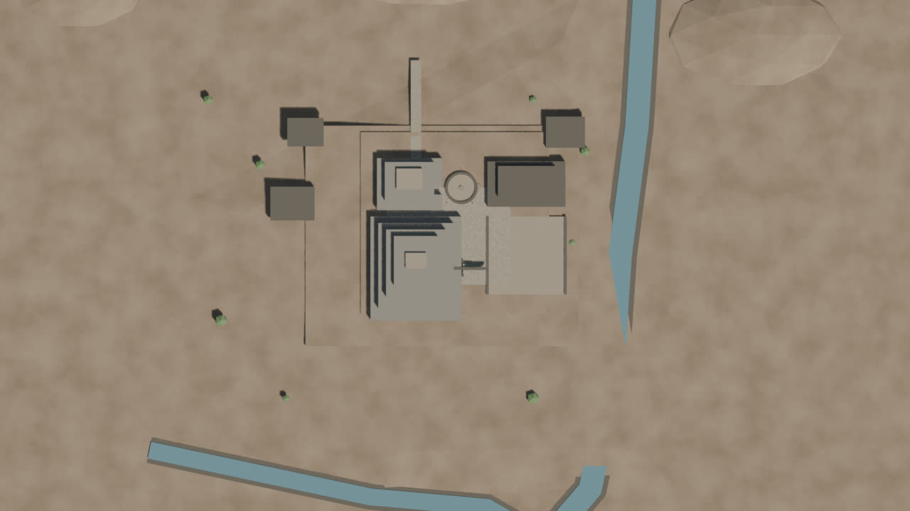
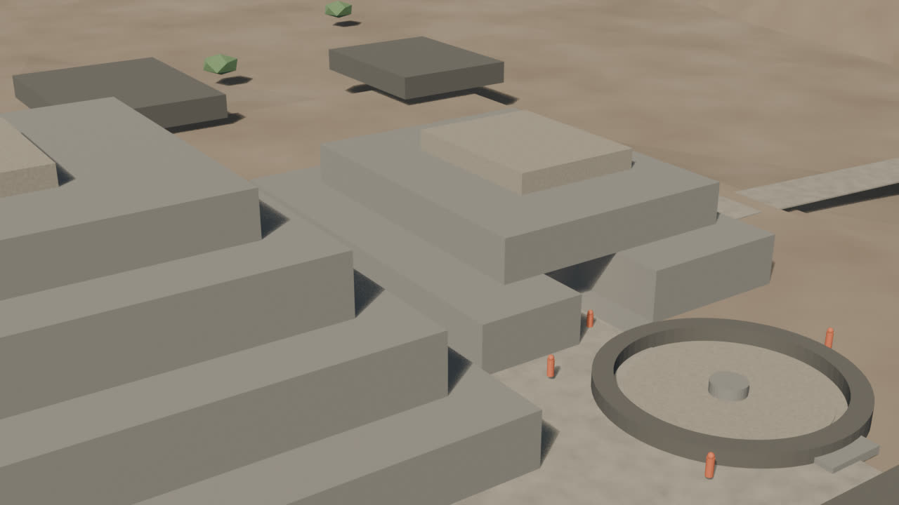
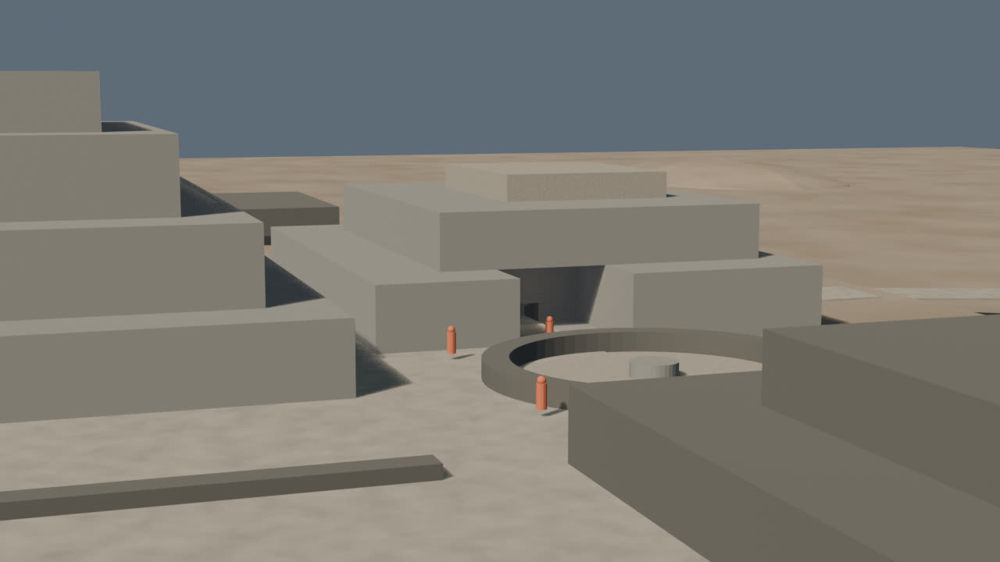
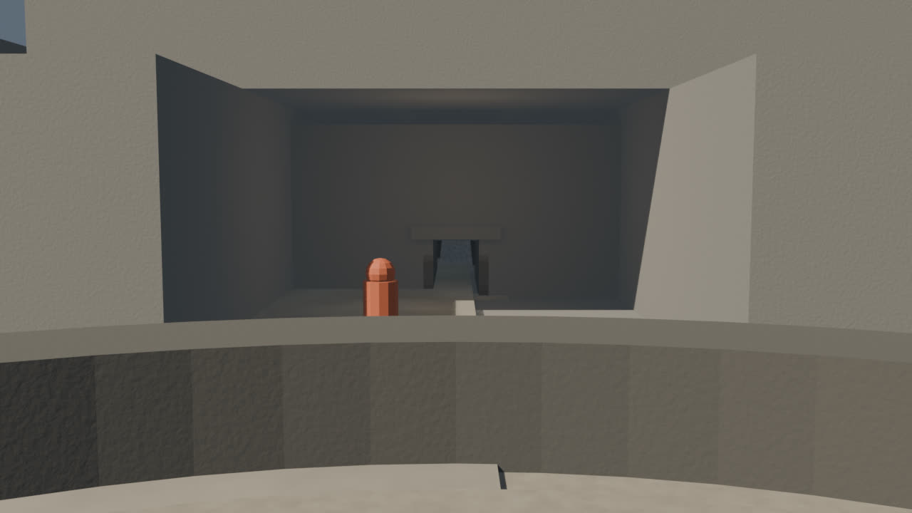
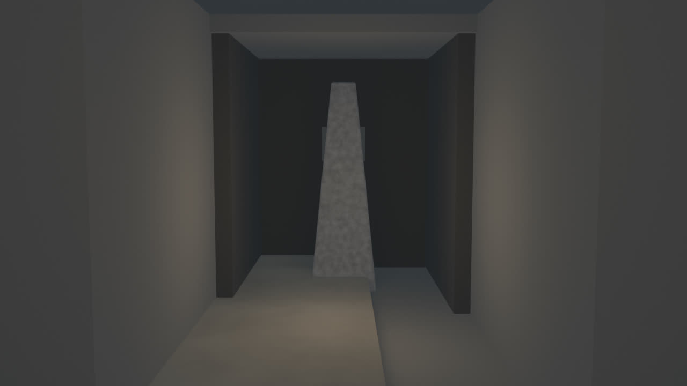
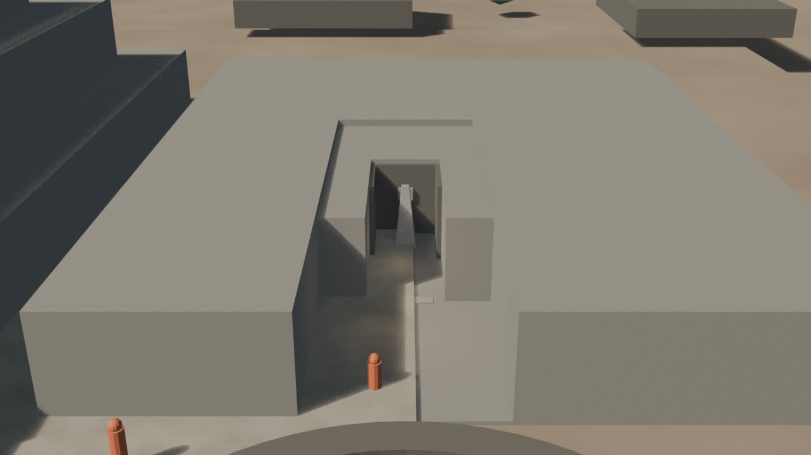

# Chavín — look-dev v0.1 (base de materiales)

Fecha: 27 de octubre de 2026.
Estado: **base material aprobada para revisión; no es acabado final**.
Fuente: `blender/chavin/chavin_lookdev_v0.1.blend` (191 KB).
Base de escala: `blockout-v0.5.md` (aceptada).
Decisión de terreno: `terrain.md`.

## Vistas

### Hero

### Planta

### Núcleo

### Galería

### Portal y atrio

### Lanzón

### Sección de revisión

## Qué cambió respecto a v0.5

- **Materiales procedurales** para piedra clara, piedra oscura, plaster/pisos, tierra, camino, vegetación, agua, Lanzón y galería.
- **Piedra:** gris cálido con variación de grano fino y bump; sin juntas de mampostería.
- **Pisos:** plaster de cal/arena cálido, sin blancos de blockout.
- **Tierra y caminos:** tonos más oscuros para separar el sitio del terreno.
- **Agua:** azul verdoso con rugosidad baja.
- **Lanzón:** granito medio, sin talla ni relieve.
- **Galería:** interior casi negro para leer el vano.
- **Luces:** sol cálido de 5,5; relleno frío de 280; mundo a 0,42; exposición −0,3.
- **Sin cambios de geometría:** 97 mallas, 2.148 vértices y 3.852 tris.

## Materiales

| Material | Uso | Acabado |
|---|---|---|
| `MAT-Chavin_Stone` | Edificios A/B, terrazas, muros | Piedra cálida, rugosa |
| `MAT-Chavin_StoneDark` | Plataformas, dinteles, escaleras | Piedra oscura |
| `MAT-Chavin_Plaster` | Pisos y plazas | Cal/arena compacta |
| `MAT-Chavin_Earth` | Valle, cerros, explanada | Tierra seca |
| `MAT-Chavin_Path` | Caminos y rampas | Tierra compactada |
| `MAT-Chavin_Vegetation` | Arbustos | Verde apagado |
| `MAT-Chavin_Water` | Ríos Mosna y Wacheqsa | Agua turbia |
| `MAT-Chavin_Lanzon` | Monolito | Granito medio |
| `MAT-Chavin_GalleryDark` | Vano de la Portada | Sombra profunda |
| `MAT-Chavin_Reference` | Figuras de escala | Naranja de referencia |

## Evidencia e inferencia

- La paleta de piedra, tierra y agua es **interpretativa**; no hay medición de color del sitio.
- No se afirma un tipo de cantería ni un acabado superficial.
- Las dimensiones siguen siendo las de v0.5; este pase no añade evidencia nueva.
- La figura naranja es una **referencia de escala**, no una reconstrucción de vestimenta.

## Límites

- **Sin texturas externas:** todo es procedural.
- Las procedurales **no exportan a glTF**; habrá que hornearlas antes del GLB.
- No hay juntas de mampostería, relieves, tallas ni desgaste arqueológico.
- El Lanzón sigue siendo un volumen; no tiene rostro ni iconografía.
- El terreno sigue siendo procedural; **no hay DEM**.
- Las vistas de Lanzón y sección siguen siendo cutaways de revisión, no secciones arqueológicas.
- No hay assets web, `city.json` ni GLB.

## Revisión

- La piedra se lee uniforme; el siguiente pase debe introducir juntas de mampostería o una textura CC0 horneada.
- El atrio y el portal conservan la escala aprobada en v0.5.
- El Lanzón ya no parece yeso; el granito medio es una base, no un acabado final.
- El hero conserva la composición de v0.5; no se toca la cámara todavía.

## Siguiente

1. Añadir juntas de mampostería o textura CC0 de piedra y medir el coste.
2. Decidir DEM vs. procedural para el terreno.
3. Hornear materiales para el futuro GLB.
4. Portada de las Falcónidas, relieves y LOD.
5. Visor web solo después.
