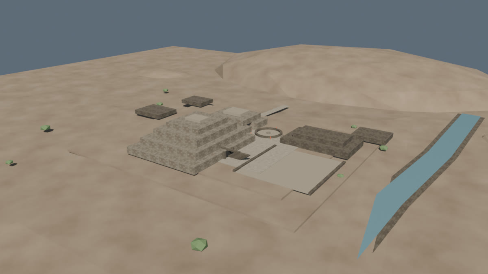
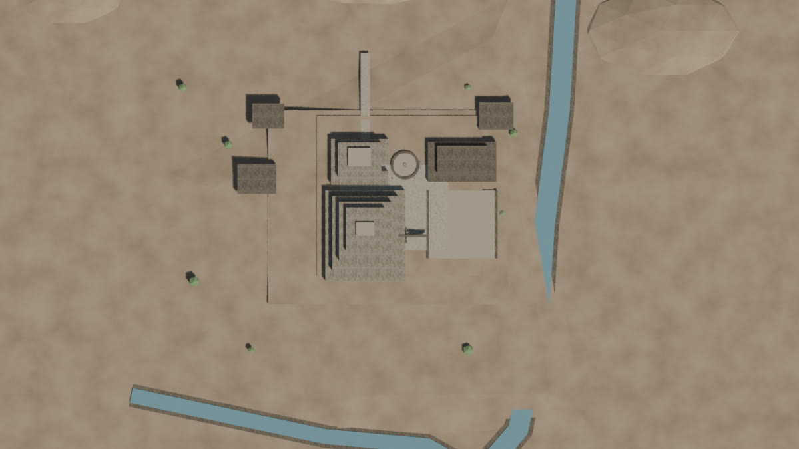
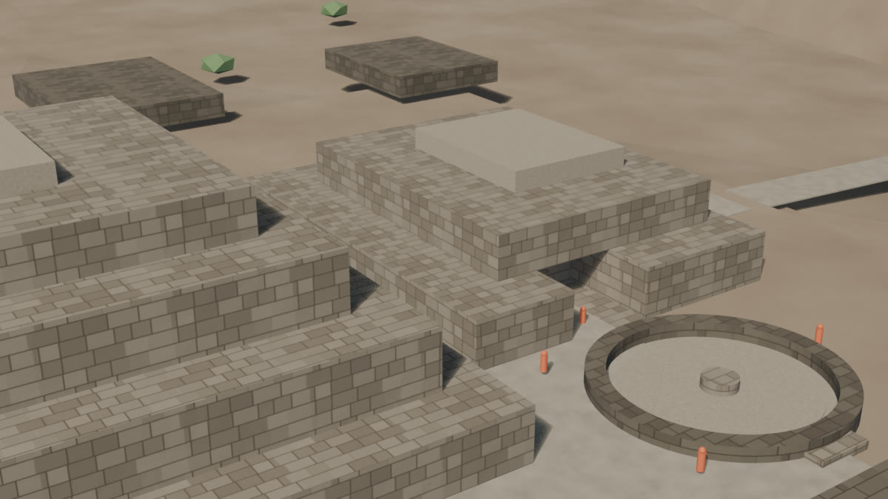
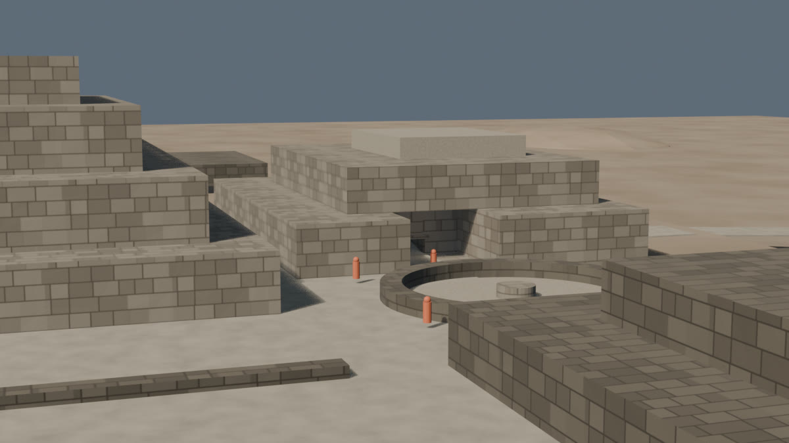
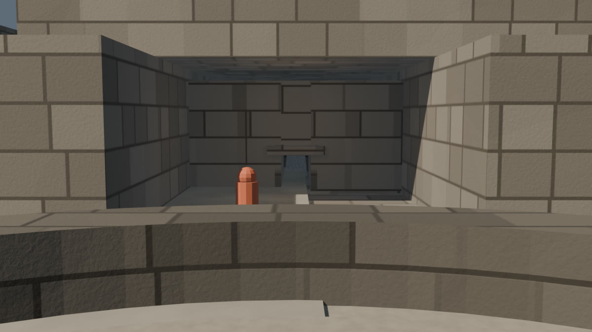
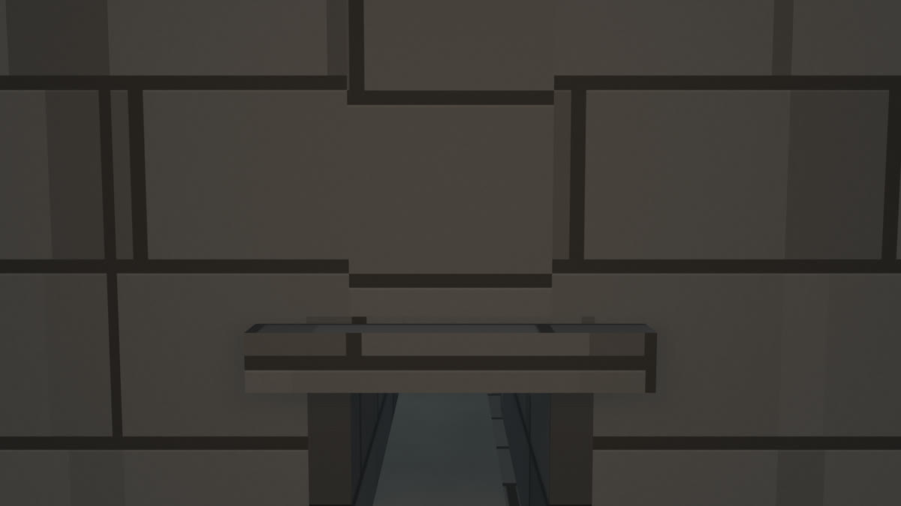
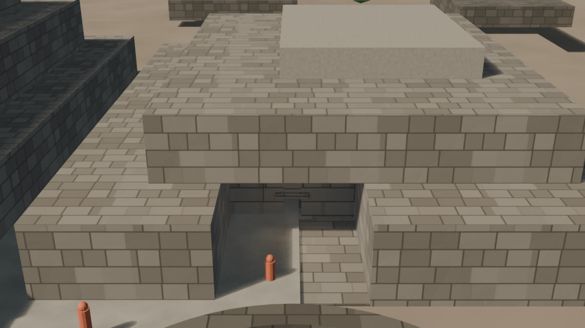

# Chavín — look-dev v0.2 (mampostería ashlar)

Fecha: 27 de octubre de 2026.
Estado: **pase de mampostería histórico; superado por `textured-v0.2.md`**.
Fuente: `blender/chavin/chavin_lookdev_v0.2.blend` (585 KB).
Base de escala: `blockout-v0.5.md` (aceptada).
Pase anterior: `lookdev-v0.1.md` (histórico).
Decisión de terreno: `terrain.md`.

## Vistas

### Hero

### Planta

### Núcleo

### Galería

### Portal y atrio

### Lanzón

### Sección de revisión

## Qué cambió respecto a v0.1

- **Piedra clara y oscura:** pasan de color uniforme a una textura de **mampostería ashlar** con juntas visibles.
- **Textura propia:** `scripts/make_chavin_materials.py` genera diffusión, rugosidad y normal 2K con semilla 151; no se reutilizan texturas de Caral, no hay IA y no hay descarga externa.
- **Proyección:** las texturas usan coordenadas de objeto y proyección **Box**; no hay UVs todavía.
- **Escala visual:** 7 hiladas por tile; a 10 m de tile las hiladas rondan 1,4 m y los bloques 1,4–3,3 m. Es una **base interpretativa**, no un levantamiento de bloques.
- **Relieve:** bump fino por ruido y un segundo bump por Voronoi de borde; las juntas se leen, pero no hay desplazamiento real.
- **Materiales oscuros:** `MAT-Chavin_StoneDark` usa la misma familia con tinte más oscuro; plataformas, dinteles, escaleras y galería conservan su jerarquía.
- **Lanzón:** sin cambios; sigue siendo un volumen ahusado sin talla.
- **Sin cambios de geometría ni de cámara:** 97 mallas, 2.148 vértices y 3.852 tris.
- **Sin cambios de luces:** se conserva el pase de v0.1.

## Texturas

| Archivo | Resolución | Uso | Licencia |
|---|---|---|---|
| `blender/textures/chavin/chavin_ashlar_diffuse.jpg` | 2048² | Color de piedra | Generada por el proyecto |
| `blender/textures/chavin/chavin_ashlar_roughness.jpg` | 2048² | Rugosidad | Generada por el proyecto |
| `blender/textures/chavin/chavin_ashlar_normal.png` | 2048² | Normal para un bake futuro | Generada por el proyecto |

El `.blend` lleva empaquetadas la difusa y la rugosidad. La normal está generada pero **no conectada** todavía, porque el material usa Box projection sin UVs.

## Materiales

| Material | Uso | Acabado |
|---|---|---|
| `MAT-Chavin_Stone` | Edificios A/B, terrazas, muros | Ashlar claro, juntas visibles |
| `MAT-Chavin_StoneDark` | Plataformas, dinteles, escaleras | Ashlar oscuro |
| `MAT-Chavin_Plaster` | Pisos y plazas | Cal/arena compacta |
| `MAT-Chavin_Earth` | Valle, cerros, explanada | Tierra seca |
| `MAT-Chavin_Path` | Caminos y rampas | Tierra compactada |
| `MAT-Chavin_Vegetation` | Arbustos | Verde apagado |
| `MAT-Chavin_Water` | Ríos Mosna y Wacheqsa | Agua turbia |
| `MAT-Chavin_Lanzon` | Monolito | Granito medio |
| `MAT-Chavin_GalleryDark` | Vano de la Portada | Sombra profunda |
| `MAT-Chavin_Reference` | Figuras de escala | Naranja de referencia |

## Evidencia e inferencia

- La **mampostería ashlar** es una base visual interpretativa; no se afirma que todas las fachadas de Chavín usaran bloques regulares de este tamaño.
- El color y la rugosidad son interpretativos; no hay medición de color ni de acabado del sitio.
- Las dimensiones de los bloques no provienen de un levantamiento; solo se usan para leer juntas a escala de conjunto.
- Las dimensiones del conjunto siguen siendo las de v0.5; este pase no añade evidencia nueva.
- La figura naranja es una **referencia de escala**, no una reconstrucción de vestimenta.

## Límites

- **Sin UVs:** Box projection no exporta limpio a glTF. Este límite se resolvió en `textured-v0.2.md`.
- **Sin bake:** el `.blend` es una fuente de trabajo; no hay texturas de GLB.
- **Normal no conectada:** el relieve actual es bump procedural; la normal 2K queda para el bake.
- El Lanzón sigue siendo un volumen; no tiene rostro, talla ni iconografía.
- La Portada de las Falcónidas, relieves y cabezas clavas siguen fuera de este pase.
- El terreno sigue siendo procedural; **no hay DEM** y no se cita como topografía.
- Las vistas de Lanzón y sección siguen siendo cutaways de revisión, no secciones arqueológicas.
- No hay assets web, `city.json` ni GLB de Chavín.

## Revisión

- Las juntas se leen bien en el portal, el núcleo y la sección; el hero gana textura sin perder la escala de v0.5.
- El anillo de la Plaza Circular muestra juntas segmentadas por la proyección Box; es aceptable para una base, no para el acabado final.
- La piedra sigue siendo demasiado regular para afirmar cantería chavín; el siguiente pase debe introducir irregularidad, desgaste y variación de hiladas.
- El Lanzón y la oscuridad de galería siguen siendo los puntos fuertes del pase.

## Siguiente

1. UVs y texturizado: resuelto en `textured-v0.2.md`; el bake de atlas 2K se descartó por pérdida de detalle.
2. Decidir si el terreno se queda procedural o pasa a DEM híbrido; por ahora se queda procedural.
3. Portada de las Falcónidas, relieves, cabezas clavas y LOD.
4. Visor web solo después.
