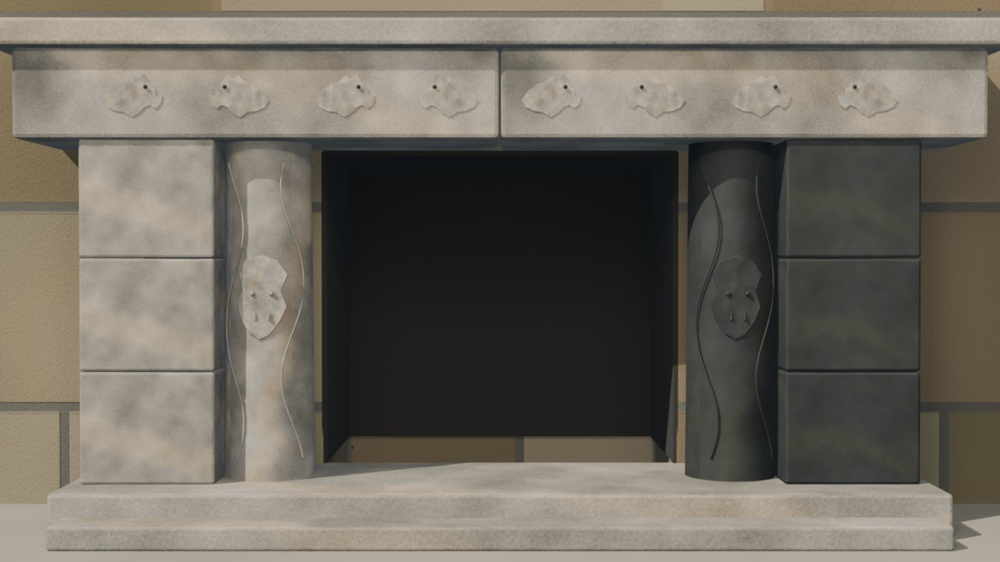
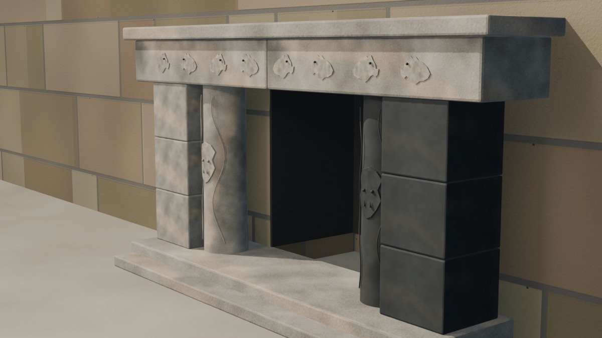
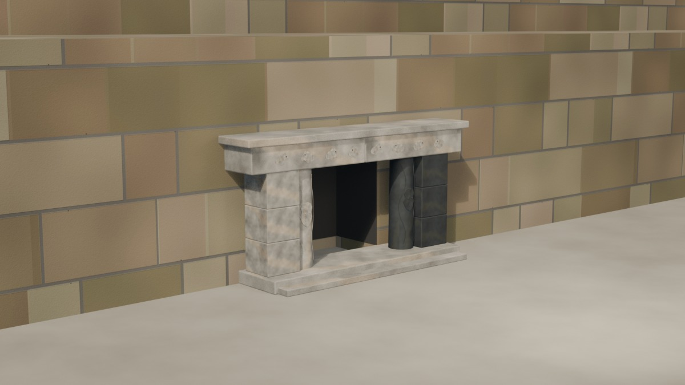

# Chavín — Portada de las Falcónidas v0.1

Fecha: 27 de octubre de 2026.
Estado: **detalle arquitectónico en revisión; relieves interpretativos**.
Fuente: `blender/chavin/chavin_portada_v0.1.blend` (7,7 MB).
Base: `chavin_textured_v0.2.blend`.

## Vistas

### Detalle frontal

### Detalle tres cuartos

### Emplazamiento en la fachada este

## Qué cambió

- Se retiró el placeholder `GEO-Chavin_EdificioA_Portada_*`: tenía columnas de 6,5 m y un dintel de 21 m, dimensiones que no correspondían a la Portada.
- Se retiraron las ocho gradas inferidas `GEO-Chavin_EdificioA_Stair_*`; no hay cota suficiente para una escalinata de 12 m de ancho.
- Se abrió un vano real de **2,6 × 2,3 m** en la fachada este del Edificio A y se añadió un fondo oscuro de 1,6 m de profundidad.
- Se construyeron dos columnas circulares de **2,30 m de alto y 0,62 m de diámetro**, dos jambas de tres piezas y un friso de **6,48 m** partido en dos.
- Se modelaron **ocho perfiles de falcónidas** en el friso y dos rostros antropomorfos abstractos en las columnas.
- Se añadió un **escalón intermedio** de 0,15 m y un umbral a 0,30 m sobre la plaza; es una inferencia, no una cota publicada.
- La mitad norte usa piedra oscura y la mitad sur piedra clara; el friso y la cornisa usan la piedra clara.
- Se añadieron dos cámaras de detalle y una luz de relleno.

## Medidas de trabajo

| Elemento | Medida | Estado |
|---|---:|---|
| Columna | 2,30 m alto; 0,61–0,62 m diámetro | Documentado; base elevada inferida |
| Jambas | 2,30 m alto; 0,90 m ancho; 3 piezas por lado | Documentado; ancho inferido |
| Friso | 6,48 m de longitud; dos piezas | Medida secundaria; pendiente de cotejo |
| Falcónidas | 8 perfiles | Documentado; número discutido (algunas fuentes citan 14 aves) |
| Vano | 2,6 m ancho × 2,3 m alto | Inferido a partir de las columnas |
| Receso | 1,6 m de profundidad | Inferido |
| Base de la portada | z = 3,8 m; umbral 0,30 m sobre la plaza | Inferido |
| Escalón de acceso | 0,15 m de altura; 5,6 m de ancho | Inferido |

No se modeló el **dintel de tres piezas** porque la fuente indica que no forma parte de la reconstrucción actual. La escalera de acceso se reduce a un escalón intermedio; su desarrollo completo no tiene cota fiable.

## Evidencia e inferencia

**Documentado o reportado:**

- La Portada se ubica en el centro del frontis este del Edificio A.
- Dos columnas circulares talladas, cada una con un ser antropomorfo.
- Columnas de 2,30 m de alto, 61 cm de diámetro y 1,91 m de circunferencia.
- Dos jambas laterales, cada una de tres piezas líticas.
- Friso voladizo con ocho seres zoomorfos falcónidos en bajorrelieve, actualmente partido en dos.
- Dintel de tres piezas, no incluido en la reconstrucción actual.
- Dualidad de piedra negra/blanca en la fachada y los seres masculino/femenino de las columnas.
- Escalera de acceso como componente del conjunto.

**Inferido en este pase:**

- Ancho del vano, profundidad del receso y separación entre columnas.
- Base de la portada a cota de la terraza actual.
- Ancho de las jambas y altura de los bloques.
- Asignación de piedra clara al sur y oscura al norte.
- Perfiles y composición de los relieves.

**Interpretativo:**

- Los relieves son una lectura geométrica y estilizada, no una reproducción iconográfica.
- Los ojos y colmillos son volúmenes de lectura, no una reconstrucción de los grabados.
- La cornisa superior se simplificó.

## Materiales y texturas

- `MAT-Chavin_Portada_Light`: caliza/granito claro cálido, con vetas suaves.
- `MAT-Chavin_Portada_Dark`: piedra oscura, con grano y poros.
- Texturas propias de 1024², sin IA: difusa, rugosidad y normal para cada familia.
- Generador: `scripts/make_chavin_portal_materials.py`.
- Las texturas están empaquetadas en el `.blend`; no se copiaron fotografías.

## Métricas

- 132 mallas, 7.381 vértices y 14.146 tris en la escena.
- La Portada aporta 47 mallas, 5.292 vértices y 10.364 tris.
- 10 cámaras, 5 luces y 12 materiales.
- GLB de prueba: 133 mallas, 14.158 tris, 12 imágenes, 11 MB; reimportado correctamente. No es un GLB de producción.
- Cámaras nuevas: `CAM-Chavin_PortadaFalconidas`, `CAM-Chavin_PortadaFalconidas_3q` y `CAM-Chavin_PortadaContext`.
- Luz nueva: `LGT-Chavin_PortadaFill`.

## Límites

- No hay dintel; la escalera de acceso se reduce a un escalón inferido.
- El friso completo es una hipótesis de lectura; su longitud y número de aves tienen variantes en las fuentes.
- Los relieves no reproducen las piezas originales ni sustituyen un levantamiento fotogramétrico.
- La base a z = 3,8 m y el escalón dependen del terreno procedural, no de una cota publicada.
- No se ha publicado `city.json`, GLB de producción ni assets web.
- No se usaron imágenes oficiales ni texturas de IA.

## Siguiente

1. Revisar la escala contra una figura de 1,7 m y decidir si se corrige el ancho del friso.
2. Resolver dintel y escalera con una fuente mejor; si no, dejarlos explícitamente fuera.
3. Decidir si los relieves se mantienen abstractos o se abre un pase iconográfico con licencia.
4. Solo después: LOD, GLB de producción y visor.

## Fuentes

- Wikipedia, *Portada de las Falcónidas*: <https://es.wikipedia.org/wiki/Portada_de_las_Falc%C3%B3nidas>. Texto CC BY-SA 4.0; medida secundaria.
- Wikimedia Commons, categoría *Portada de las Falcónidas*: <https://commons.wikimedia.org/wiki/Category:Portada_de_las_Falc%C3%B3nidas>. Licencia por archivo; consultada como referencia, no incorporada.
- Fichas y documentos de UNESCO/Mincul ya citados en `docs/fuentes/chavin.md`; no se copiaron imágenes.
