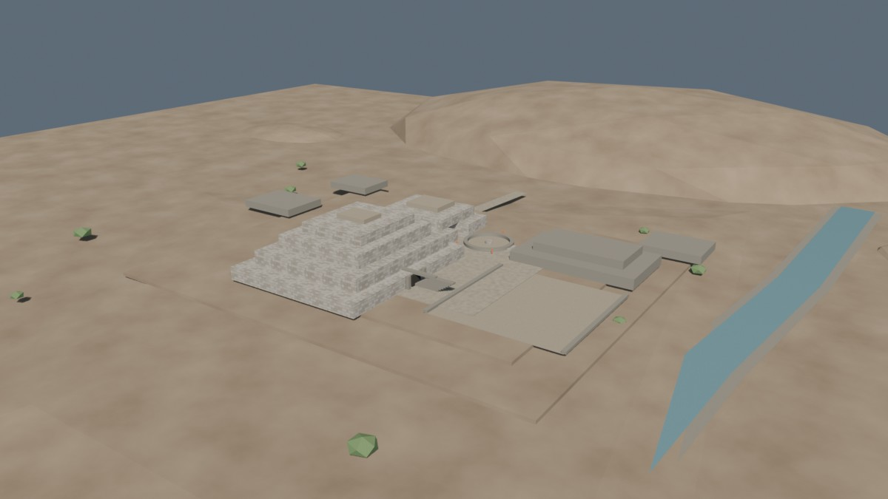
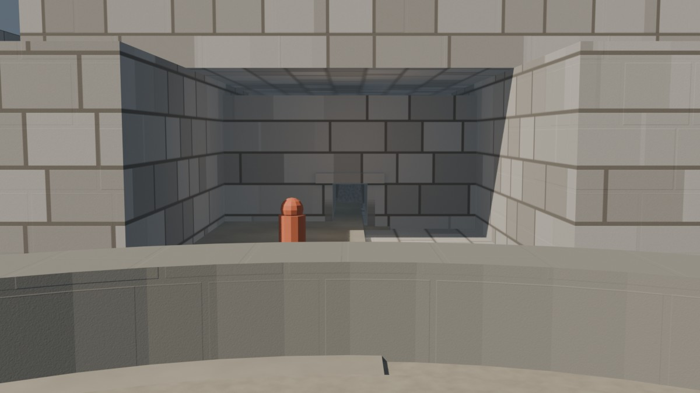

# Chavín — texturizado UV v0.1

Fecha: 27 de octubre de 2026.
Estado: **pase técnico de texturizado; no es acabado final**.
Fuente: `blender/chavin/chavin_textured_v0.1.blend` (3,3 MB).
Base: `lookdev-v0.2.md`.
Prueba descartada: atlas horneado 2K, guardado fuera del repositorio en `/tmp/chavin-bake-v0.1/`.

## Vistas

### Hero

### Portal

## Resultado

- Se sustituyó la proyección Box sin UVs por **UVs de proyección cúbica a escala mundial** y texturas con repetición.
- Los 52 objetos de piedra tienen UV: 23 con `MAT-Chavin_Stone_Tiled` y 29 con `MAT-Chavin_StoneDark_Tiled`. Los tres objetos que no tenían UV (anillo de la Plaza Circular y lechos de los ríos) quedaron resueltos.
- La mampostería se lee con nitidez en el portal y el conjunto; ya no depende de un atlas de baja densidad.
- Se conectaron las tres texturas 2K: difusa, rugosidad y normal. La normal usa `Strength = 3.0` para que las juntas se lean.
- No cambian geometría, cámaras, luces, escala ni recorrido: 97 mallas, 2.148 vértices y 3.852 tris.

## Bake técnico descartado

Se probó primero un atlas compartido por material:

- Dos grupos: `Stone` (23 objetos) y `StoneDark` (29).
- Seis imágenes de 2K: color, rugosidad y normal para cada grupo.
- Horneado en Cycles CPU, 1 muestra para color/rugosidad, margen 16.
- GLB de prueba de 12 MB; reimportó con 47 mallas, 3.852 tris, 10 materiales y seis imágenes de 2K.

El atlas era correcto técnicamente, pero **perdía demasiado detalle** en muros grandes: 2K repartidos entre 23 objetos dejan muy pocos téxeles por metro. Se descartó para piedra. La prueba queda como referencia, no como asset publicado.

## UVs y escalas

| Grupo | Objetos | UV | Repetición |
|---|---:|---|---|
| `MAT-Chavin_Stone_Tiled` | 23 | Proyección cúbica por cara | Tile de 10 m |
| `MAT-Chavin_StoneDark_Tiled` | 29 | Proyección cúbica por cara | Tile de 11,11 m |

Las UVs se calculan desde coordenadas de mundo y se dejan fuera del rango 0–1; las texturas usan `REPEAT`. Esto conserva la densidad de texel de la textura 2K original en muros de varios metros.

## Materiales

| Material | Base | Rugosidad | Normal |
|---|---|---|---|
| `MAT-Chavin_Stone_Tiled` | `chavin_ashlar_diffuse.jpg` | `chavin_ashlar_roughness.jpg` | `chavin_ashlar_normal.png` |
| `MAT-Chavin_StoneDark_Tiled` | Color oscuro uniforme | `chavin_ashlar_roughness.jpg` | `chavin_ashlar_normal.png` |

La piedra oscura conserva un color uniforme para no perder la jerarquía de plataformas, dinteles y escaleras. El color de la piedra clara es provisional y todavía no iguala el tinte cálido de v0.2.

## Texturas

| Archivo | Resolución | Uso | Licencia |
|---|---|---|---|
| `blender/textures/chavin/chavin_ashlar_diffuse.jpg` | 2048² | Color de piedra clara | Generada por el proyecto |
| `blender/textures/chavin/chavin_ashlar_roughness.jpg` | 2048² | Rugosidad | Generada por el proyecto |
| `blender/textures/chavin/chavin_ashlar_normal.png` | 2048² | Normal de juntas | Generada por el proyecto |

Las tres están empaquetadas en el `.blend`. Los bordes de las texturas son compatibles para repetición; no se usan imágenes de IA ni assets externos.

## Exportación de prueba

- GLB de prueba: `/tmp/chavin_textured_test.glb` (4,8 MB).
- Reimportado y renderizado en Blender 5.2.2 para comprobar materiales y UVs.
- No se publica como asset web: no hay `city.json` ni entrada de Chavín en el visor.

## Límites

- Las costuras de la proyección cúbica son visibles en esquinas y bordes curvos; es una base, no un unwrap de producción.
- La piedra sigue siendo demasiado regular; falta variación de hiladas, desgaste y bloques irregulares.
- La piedra oscura no tiene textura de color; puede quedar plana en primeros planos.
- El terreno, plaster, caminos, agua y vegetación siguen con materiales procedurales; no están horneados.
- El Lanzón sigue sin talla; la Portada de las Falcónidas y los relieves siguen fuera de este pase.
- No hay DEM, `city.json`, GLB publicado ni assets web de Chavín.

## Siguiente

1. Ajustar el tinte de la piedra clara y decidir si la oscura usa una difusa oscurecida.
2. Introducir irregularidad de hiladas y desgaste antes de congelar la textura.
3. Resolver las costuras de esquinas o pasar a unwrap por objeto en las zonas hero.
4. Hornear o simplificar los materiales restantes y preparar LOD/GLB solo después.
