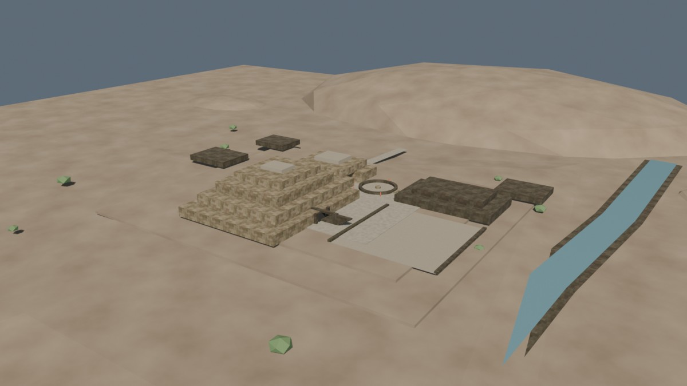
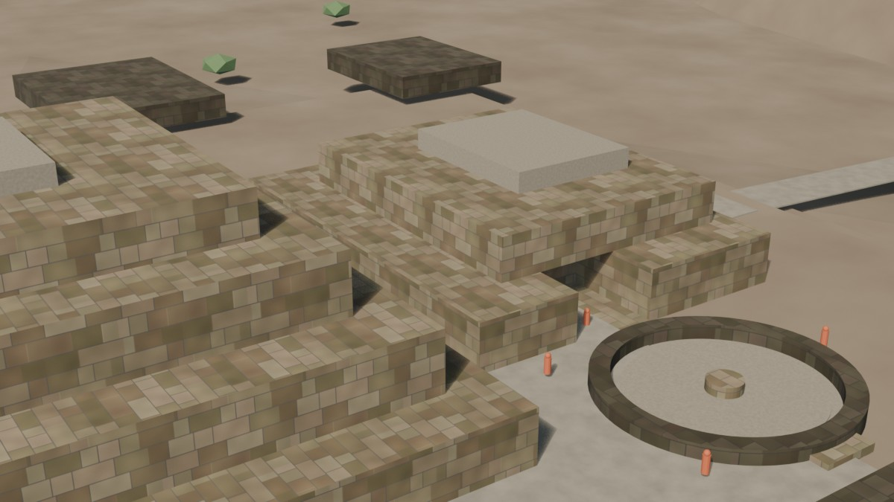
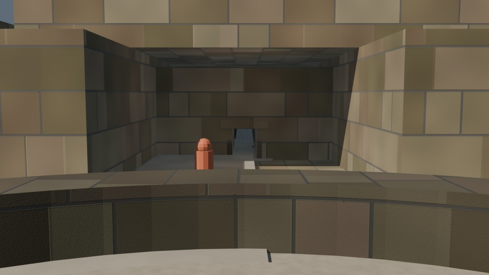

# Chavín — texturizado UV v0.2

Fecha: 27 de octubre de 2026.
Estado: **pase de acabado de piedra para revisión; no es acabado final**.
Fuente: `blender/chavin/chavin_textured_v0.2.blend` (4,2 MB).
Base: `textured-v0.1.md` (histórico).
Generador: `scripts/make_chavin_materials_v2.py`, semilla 271.

## Vistas

### Hero

### Núcleo

### Portal

## Qué cambió respecto a v0.1

- **Nueva familia de texturas 2K:** difusa cálida, difusa oscura, rugosidad y normal. La piedra clara recupera un tinte cercano al look-dev v0.2; la oscura deja de ser un color plano.
- **Ashlar menos rígido:** las hiladas tienen alturas variables, los bloques cambian de ancho y algunas esquinas tienen pequeños desportillados.
- **Variación de color:** manchas de gran escala y grano fino; las juntas siguen siendo finas para no convertir la piedra en una cuadrícula.
- **Relieve:** normal derivada de la altura del ashlar, con `Strength = 4.0`; las juntas se leen mejor que en v0.1.
- **UVs:** se mantiene proyección de cubo por cara a escala de mundo. Se probó una proyección cilíndrica para el anillo de la Plaza Circular y se descartó porque producía franjas verticales; el anillo vuelve a la proyección de cubo.
- **Sin cambios de geometría, cámaras, luces ni escala:** 97 mallas, 2.148 vértices y 3.852 tris.

## Texturas

| Archivo | Resolución | Uso | Licencia |
|---|---|---|---|
| `blender/textures/chavin/chavin_ashlar_v2_diffuse.jpg` | 2048² | Piedra clara | Generada por el proyecto |
| `blender/textures/chavin/chavin_ashlar_v2_diffuse_dark.jpg` | 2048² | Piedra oscura | Generada por el proyecto |
| `blender/textures/chavin/chavin_ashlar_v2_roughness.jpg` | 2048² | Rugosidad | Generada por el proyecto |
| `blender/textures/chavin/chavin_ashlar_v2_normal.png` | 2048² | Normal de juntas | Generada por el proyecto |

Las cuatro están empaquetadas en el `.blend` y se exportan en el GLB de prueba. Los bordes son compatibles para repetición; no se usan texturas de IA ni assets externos.

## UVs y materiales

| Grupo | Objetos | UV | Tile |
|---|---:|---|---|
| `MAT-Chavin_Stone_Tiled` | 23 | Cubo por cara, escala de mundo | 10 m |
| `MAT-Chavin_StoneDark_Tiled` | 29 | Cubo por cara, escala de mundo | 11,11 m |

Los 52 objetos de piedra tienen UV, incluidos los tres que originalmente no tenían. La piedra clara y la oscura comparten rugosidad y normal; cada una usa su propia difusa.

## Exportación de prueba

- GLB: `/tmp/chavin_textured_v02_test.glb` (5,5 MB).
- Reimportado en Blender 5.2.2: 97 mallas, 3.852 tris, 10 materiales y cuatro imágenes de 2K.
- No se publica como asset web: no hay `city.json` ni entrada de Chavín en el visor.

El atlas horneado de 2K de v0.1 sigue descartado por pérdida de detalle; esta versión usa texturas repetidas en lugar de un atlas.

## Evidencia e inferencia

- El ashlar, el color y el desgaste son **interpretativos**; no hay levantamiento de bloques ni medición de color del sitio.
- La escala de las hiladas sigue siendo la base de v0.5: 7 hiladas por tile de 10 m.
- La piedra oscura no implica un tipo de roca distinto; marca jerarquía visual entre plataformas, dinteles y escaleras.
- No se añade evidencia arqueológica nueva.

## Límites

- Las costuras de la proyección cúbica siguen visibles en esquinas y bordes curvos.
- La piedra todavía es demasiado regular para afirmar cantería chavín; faltan bloques de tamaño muy variable, erosión profunda y juntas irregulares.
- No hay desplazamiento real ni geometría de juntas; todo el relieve es normal map.
- El terreno, plaster, caminos, agua y vegetación siguen con materiales procedurales y no están horneados.
- El Lanzón sigue sin talla; la Portada de las Falcónidas y los relieves siguen fuera de este pase.
- No hay DEM, `city.json`, GLB publicado ni assets web de Chavín.

## Siguiente

1. Revisar las tres vistas y decidir si la piedra se acepta como base.
2. Si se acepta, abrir la **Portada de las Falcónidas** y sus relieves; si no, corregir primero las costuras de esquina y la variación de bloques.
3. Preparar LOD/GLB de producción después de cerrar la piedra y la portada.
