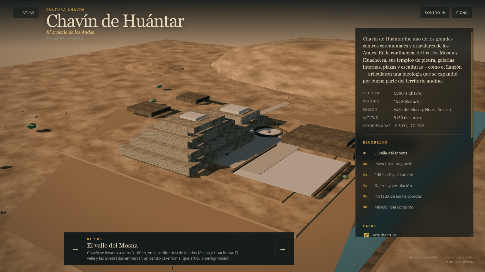
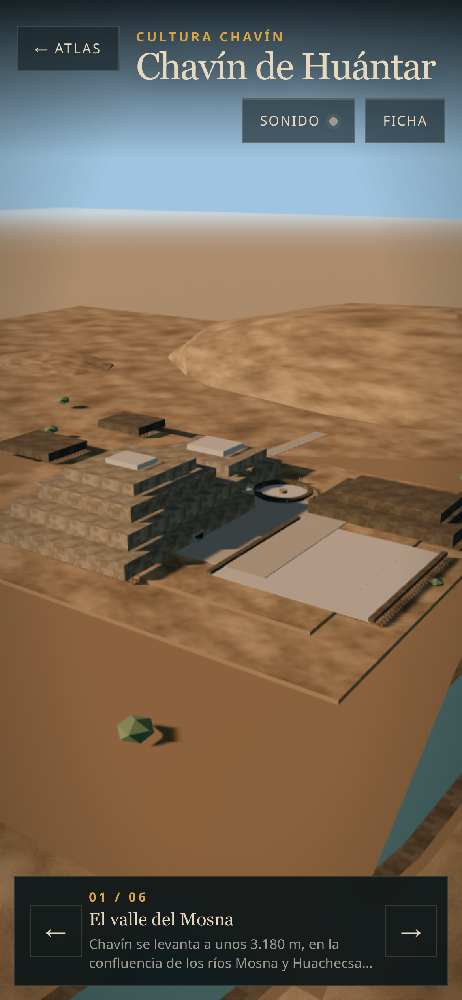
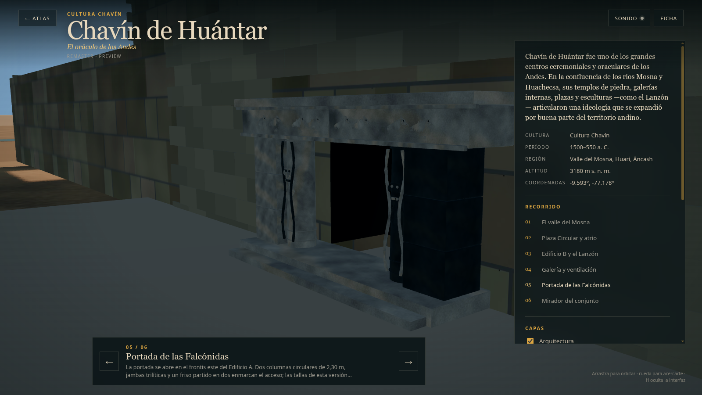
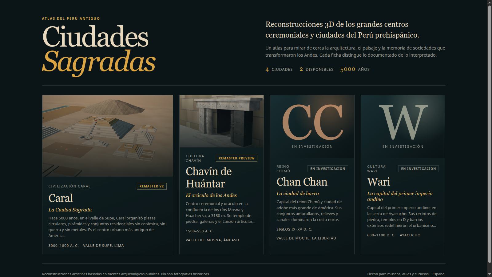

# Chavín — preview web v0.1

Fecha: 27 de octubre de 2026.
Estado: **preview público controlado; no es un remaster final ni un LOD de producción**.
Modelo: `public/cities/chavin/model_lod0.glb` y `model_lod1.glb`.
Fuente Blender: `chavin_highpoly_v0.1.blend`; los derivados `chavin_lod0.blend` / `chavin_lod1.blend` se regeneran con scripts y no se versionan.

## Vistas

### Escritorio, LOD0



### Móvil, LOD1



### Parada de la Portada



### Catálogo



## Qué se integró

- `city.json` con `status: "available"` y `stage: "preview"`.
- Dos niveles: LOD0 de 174.582 tris con mampostería y talla; LOD1 de 18.738 tris sin los detalles high-poly.
- `scale: 0.08`, cámara inicial, seis paradas de recorrido y `minDistance: 0.08` para inspección cercana.
- Capas `city`, `terrain`, `props` y `reference`, exportadas en los extras del GLB.
- `hero.jpg` propio desde la Portada, sin imágenes oficiales.
- Terreno con textura propia 1K en el GLB.
- Caché del service worker `v13`.

## Métricas del preview

| Métrica | LOD0 | LOD1 |
|---|---:|---:|
| Triángulos | 174.582 | 18.738 |
| Mallas exportadas | 4 | 4 |
| Draw calls en la vista inicial | 20 | 15 |
| GLB | 1.846.904 B | 751.384 B |
| Texturas decodificadas estimadas | 133,3 MB | 69,3 MB |
| Imágenes | 13 | 13, a 1024 px |

- `?lod=0` fuerza LOD0; `?lod=1` fuerza LOD1.
- Móvil emulado selecciona LOD1, que omite los bloques de fachada y la talla del Lanzón.
- Sin LOD0, el visor cae a LOD1.
- No hay fallback v1 independiente: LOD1 es el fallback de este preview.
- Offline probado con LOD0 tras regenerar los assets; repetir en QA de hardware.

## QA ejecutado

- `npm run validate`: OK.
- `npm run build`: OK.
- LOD0/LOD1 y las cámaras del recorrido se midieron con `bench --city chavin --qa`, incluida la captura de las seis paradas. El benchmark de hardware real queda pendiente.
- Escritorio 1600×900: LOD0, 20 draw calls.
- Móvil 390×844: LOD1, 15 draw calls.
- Seis paradas verificadas; la Portada se revisa a 0,86 m de escena y el Lanzón desde el corredor.
- Capas presentes en los extras: `city`, `terrain`, `props`, `reference`.
- Consola sin errores en las cargas medidas.

Los FPS de SwiftShader no representan hardware real y no se usan como certificación.

## Cambios de visor

- Se añadió `city.minDistance` y `city.maxDistance` a `CityViewer`.
- Chavín usa `minDistance: 0.08` para permitir la inspección cercana de la Portada; Caral conserva el valor por defecto de 5.
- El resto de la lógica de LOD, capas y fallback se reutiliza sin cambios.

## Límites

- El LOD0 está dentro del presupuesto de producción de 150.000–250.000 tris, pero 107.932 tris se concentran en la mampostería de fachada.
- El LOD1 no es un bake de alta fidelidad; elimina bloques de fachada, ojos, colmillos y serpentinas del relieve.
- El terreno es procedural; sus tres texturas propias (difusa, rugosidad y normal) se generan por `scripts/make_chavin_terrain_materials.py` y no constituyen topografía levantada.
- La Portada mantiene relieves interpretativos; el dintel no se modela y la escalera es un solo escalón inferido.
- El frente tallado del Lanzón se revisa con la cámara de QA; el recorrido público lo muestra desde el corredor y en penumbra.
- No hay QA en hardware real ni certificación de 60 fps.
- No se copiaron imágenes oficiales ni se usaron texturas de IA.
- El preview no debe presentarse como remaster v2.

## Reproducir

```bash
blender --background blender/chavin/chavin_portada_v0.1.blend \
  --python scripts/build_chavin_lod.py -- --lod 0 \
  --out-blend blender/chavin/chavin_lod0.blend

blender --background blender/chavin/chavin_lod0.blend \
  --python scripts/export_chavin_lod.py -- \
  --out public/cities/chavin/model_lod0.glb

npm run validate
npm run build
npm run bench -- --city chavin --out /tmp/chavin-final --qa
```
