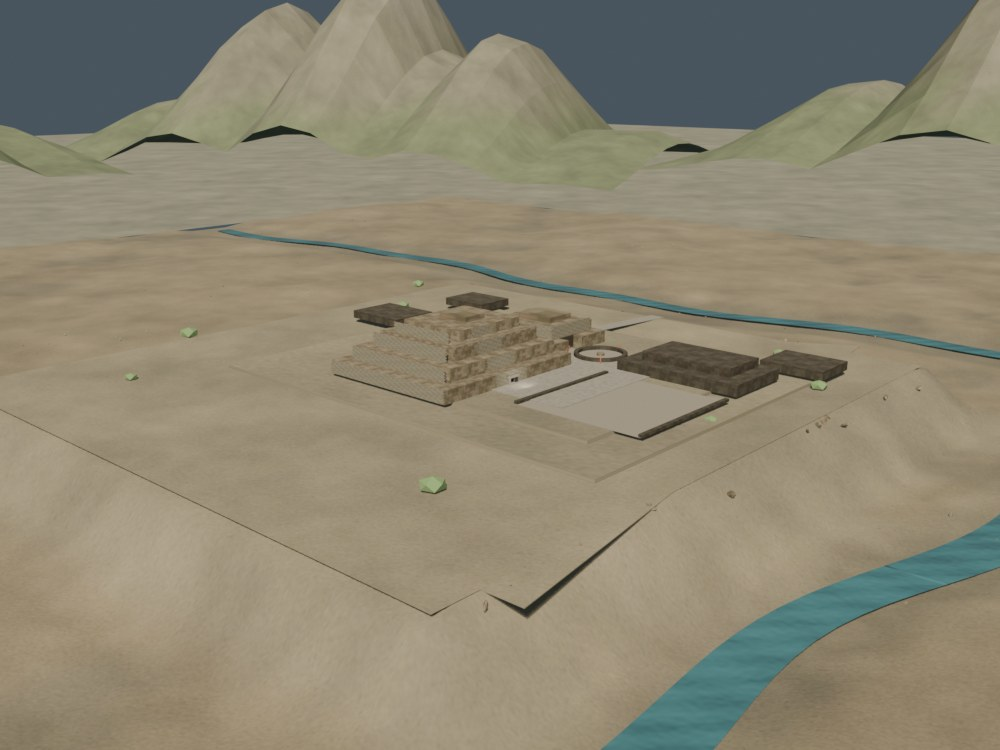
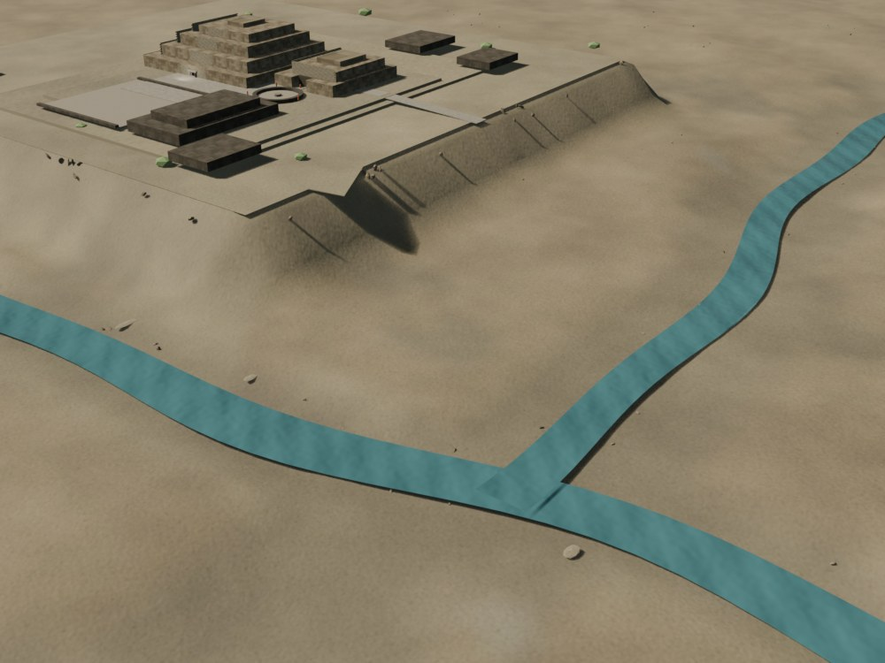

# Chavín — preview web v0.3

Fecha: 31 de octubre de 2026.
Estado: **preview público controlado; no es un remaster final ni un LOD de producción**.
Modelo: `public/cities/chavin/model_lod0.glb` y `model_lod1.glb`.
Fuente Blender: `chavin_highpoly_v0.7.blend`; los derivados `chavin_lod0.blend` / `chavin_lod1.blend` se regeneran con scripts y no se versionan. El Lanzón deriva del escaneo CyArk/Google Arts & Culture (CC BY-NC-SA 4.0).

## Vistas

### Escritorio, LOD0


### Valle, LOD0



### Móvil, LOD1



### Parada de la Portada


### Catálogo


## Qué se integró

- `city.json` con `availability: "available"`, `maturity: "preview"`, `version: "v0.3"`, `evidence: "mixed"` y `qa: "partial"`.
- Dos niveles: LOD0 de 249.830 tris con mampostería, friso integrado, Lanzón escaneado y valle procedural; LOD1 de 42.951 tris medidos por accessors con una copia de 12.000 tris del Lanzón.
- `scale: 0.08`, cámara inicial, seis paradas de recorrido y `minDistance: 0.1` para el primer plano del Lanzón.
- Capas `city`, `terrain`, `props` y `reference`, exportadas en los extras del GLB.
- `hero.jpg` propio desde la Portada, sin imágenes oficiales.
- Valle procedural v0.7: Mosna ~30 m abajo, Wacheqsa al norte, confluencia al noreste, crestas y vegetación baja.
- Terreno con textura propia 1K, vertex colors y normal de agua; 14 imágenes en el GLB.
- Caché del service worker `v37`.
- Parada 5 con `fov 28` para que las columnas y el friso de la Portada entren en el encuadre; las acanaladuras son una lectura geométrica interpretativa.

## Métricas del preview

| Métrica | LOD0 | LOD1 |
|---|---:|---:|
| Triángulos | 249.830 | 42.951 |
| Mallas exportadas | 4 | 4 |
| Draw calls en la vista inicial | 19 | 16 |
| GLB | 1.736.128 B | 744.652 B |
| Texturas decodificadas estimadas | 134,7 MB | 70,7 MB |
| Imágenes | 14 | 14, a 1024 px |

- `?lod=0` fuerza LOD0; `?lod=1` fuerza LOD1.
- Móvil emulado selecciona LOD1, que omite bloques de fachada, conserva una copia de 12.000 tris del Lanzón y reduce vegetación.
- Sin LOD0, el visor cae a LOD1.
- No hay fallback v1 independiente: LOD1 es el fallback de este preview.
- Offline probado con LOD0 tras regenerar los assets; repetir en QA de hardware.

## QA ejecutado

- `npm run validate`: OK.
- `npm run build`: OK.
- LOD0/LOD1 y las cámaras del recorrido se midieron con `bench --city chavin --qa`, incluida la captura de las seis paradas. El benchmark de hardware real queda pendiente.
- Escritorio 1600×900: LOD0, 19 draw calls, 60,0 fps en Intel RPL-S; LOD1, 16 draw calls, 60,0 fps.
- Móvil 390×844 emulado: LOD1, 16 draw calls.
- Seis paradas verificadas; el acercamiento mínimo al Lanzón equivale a 1,25 m del modelo (0,1 unidades de escena) y se ilumina con dos luces puntuales cálida/fría.
- Capas presentes en los extras: `city`, `terrain`, `props`, `reference`.
- Consola sin errores en las cargas medidas.
- Desktop real: `docs/qa/resultados/chavin-v07-desktop-2026-10-31/`.

Los FPS de SwiftShader no representan hardware real y no se usan como certificación.

## Cambios de visor

- Se añadió `city.minDistance` y `city.maxDistance` a `CityViewer`.
- Chavín usa `minDistance: 0.1` para el primer plano del Lanzón; Caral conserva el valor por defecto de 5.
- Se añadió `city.lights` a `CityViewer`; Chavín usa una luz puntual cálida en la Galería del Lanzón para revelar la incisión sin iluminar todo el recinto.
- El resto de la lógica de LOD, capas y fallback se reutiliza sin cambios.

## Límites

- El LOD0 queda dentro del techo nominal de 250.000; la mampostería de fachada concentra la mayor parte y las columnas añaden 1.600 tris netos.
- El LOD1 no es un bake de alta fidelidad; elimina bloques de fachada y conserva el Lanzón a 12.000 tris.
- El terreno es procedural; sus texturas propias (difusa, rugosidad y normal) se generan por `scripts/make_chavin_terrain_materials_v2.py` y no constituyen topografía levantada.
- El Mosna se sitúa ~30 m por debajo del sitio; el Wacheqsa al norte. El trazado fino, las crestas y la vegetación son inferidos.
- El agua es una superficie simplificada y opaca en el visor; no simula caudal.
- La Portada mantiene relieves interpretativos y fustes acanalados; el dintel no se modela y la escalera es un solo escalón inferido.
- El Lanzón es una adaptación del escaneo CyArk (CC BY-NC-SA 4.0), no la textura fotográfica original; el primer plano depende de la luz y del ancho de la galería.
- Desktop real 1600×900 aprobado; móvil físico y 1080p real siguen pendientes.
- No se copiaron imágenes oficiales ni se usaron texturas de IA.
- El preview no debe presentarse como remaster v2.

## Reproducir

```bash
blender --background blender/chavin/chavin_highpoly_v0.2.blend \
  --python scripts/build_chavin_lanzon_scan_v0_3.py -- \
  --scan /ruta/lanzon_cyark.glb \
  --out-blend blender/chavin/chavin_highpoly_v0.3.blend --no-bake

blender --background blender/chavin/chavin_highpoly_v0.3.blend \
  --python scripts/build_chavin_portada_columns.py -- \
  --out-blend blender/chavin/chavin_highpoly_v0.4.blend

blender --background blender/chavin/chavin_highpoly_v0.4.blend \
  --python scripts/fix_chavin_summit_blocks.py -- \
  --out-blend blender/chavin/chavin_highpoly_v0.5.blend

blender --background blender/chavin/chavin_highpoly_v0.5.blend \
  --python scripts/add_chavin_tier_supports.py -- \
  --out-blend blender/chavin/chavin_highpoly_v0.6.blend

python3 scripts/make_chavin_terrain_materials_v2.py

blender --background blender/chavin/chavin_highpoly_v0.6.blend \
  --python scripts/build_chavin_valley_v0_7.py -- \
  --out-blend blender/chavin/chavin_highpoly_v0.7.blend

blender --background blender/chavin/chavin_highpoly_v0.7.blend \
  --python scripts/build_chavin_lod.py -- --lod 0 \
  --out-blend blender/chavin/chavin_lod0.blend

blender --background blender/chavin/chavin_lod0.blend \
  --python scripts/export_chavin_lod.py -- \
  --out public/cities/chavin/model_lod0.glb

npm run validate
npm run build
npm run bench -- --city chavin --out /tmp/chavin-final --qa
```
