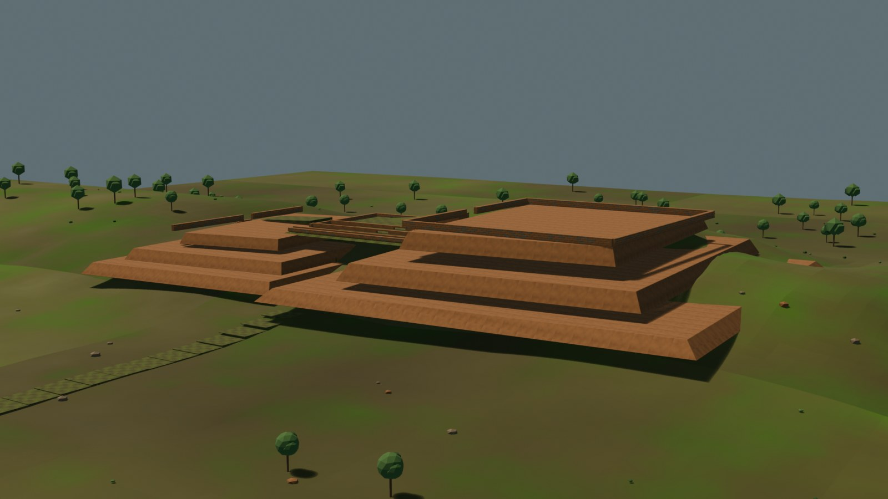
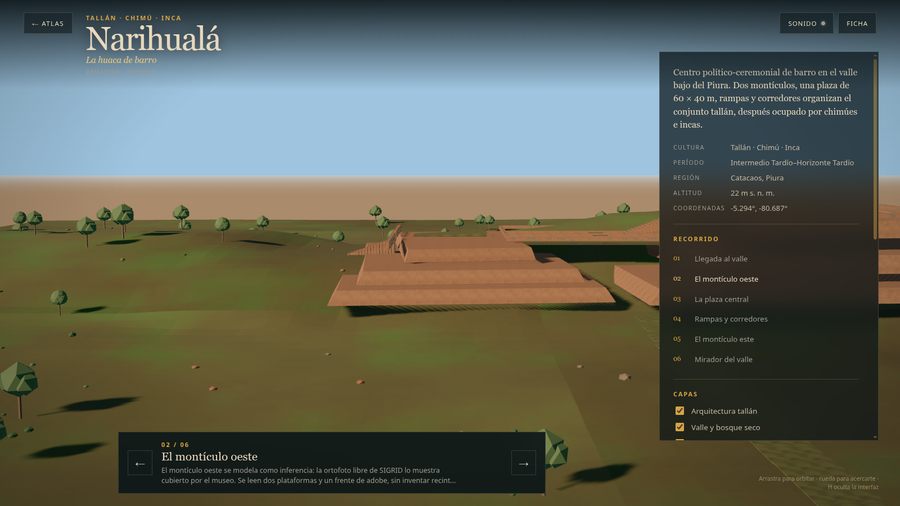
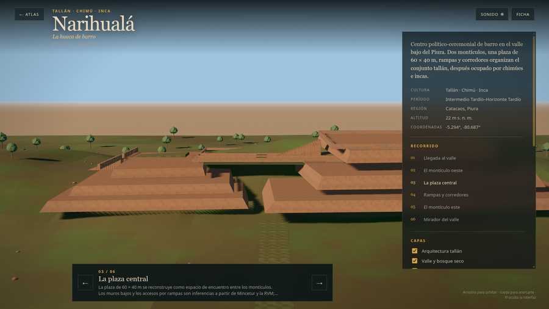
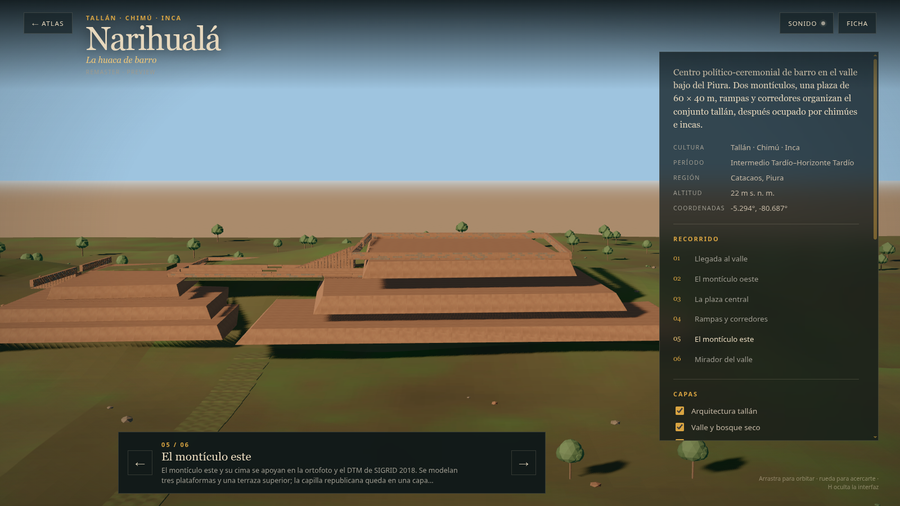

# Narihualá — remaster

Estado: **preview web v0.2 interpretativo; no reconstrucción final**.
Fuente: `blender/narihuala/narihuala_highpoly_v0.2.blend` (6,2 MB).
LOD0: **175.724 tris / 1.739.336 B**; LOD1: **26.894 tris / 393.000 B**; 14/13 draw calls.
Caché `v29`.

Narihualá es el principal conjunto monumental de adobe de la cultura Tallán, en Catacaos. Dos montículos, una plaza de 60 × 40 m, rampas y corredores organizan el sitio, ocupado también por chimúes e incas. La capilla republicana de la cima se trata como añadido posterior.

## Documentos

- `plan.md`: alcance, presupuesto, recorrido, riesgos y gate.
- `planta-cotas.md`: envolvente legal, SIGRID y límites de la planta.
- `planta-interpretativa.md`: qué es visible, qué es inferido y qué no se modela.
- `cobertura.md`: elementos documentados, inferidos y diferidos.
- `referencias.md`: fuentes, licencias y criterios de imagen.
- `web-preview.md`: assets, métricas, QA y límites.
- Dossier de fuentes: [`../../fuentes/narihuala.md`](../../fuentes/narihuala.md).

## Vistas

### High-poly

### Montículo oeste

### Plaza central

### Montículo este

## Límites

- El montículo este y la capilla se apoyan en SIGRID 2018; el montículo oeste y la plaza son inferencias.
- No hay plano arqueológico de sectores; la numeración I–III no se asigna.
- No se reconstruyen techos, alturas originales ni recintos interiores.
- La capilla va en `later`, apagada por defecto.
- No hay QA en hardware real.
