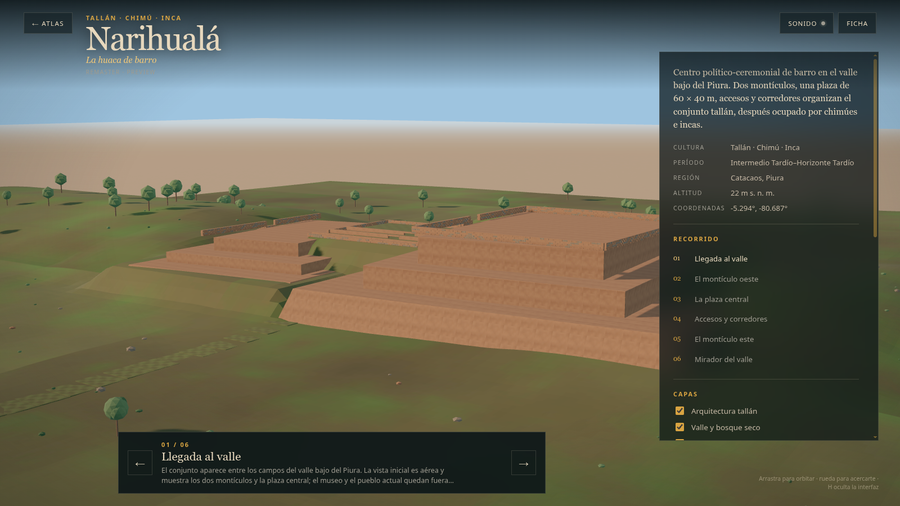

# Narihualá — preview web v0.2

Fecha: 29 de octubre de 2026.
Estado: **preview interpretativo; no reconstrucción final**.
Modelo: `public/cities/narihuala/model_lod0.glb` y `model_lod1.glb`.
Fuente: `blender/narihuala/narihuala_highpoly_v0.2.blend`.

## Qué se integró

- LOD0: **162.432 tris / 1.599.008 B**; LOD1: **29.682 tris / 441.800 B**.
- 14/13 draw calls; 96/48 MB de texturas; 2K/1K.
- Seis paradas: valle, montículo oeste, plaza, accesos, montículo este y mirador.
- Capas: arquitectura tallán, valle y bosque seco, detalles, escala humana y capilla republicana (`later`, apagada).
- `scale: 0.08`; caché global `v36`.
- `lighting` es un override opcional de `fill`, `hemiIntensity` y `envIntensity`; solo se aplica a esta ciudad y no cambia el preset global.

## Vistas

### Hero

### Montículo oeste

### Plaza central

### Montículo este

## Lectura

- El montículo este y la capilla se apoyan en SIGRID 2018.
- El montículo oeste, la plaza y los accesos son inferencias explícitas; el terreno se recorta localmente para exponer el oeste; las rampas documentadas no se modelan y se sustituyen por escalinatas apoyadas.
- La capilla no se muestra en el hero; está en `later`.
- No se asigna la numeración I–III.

## Límites

- No es un plano arqueológico; el cierre de cotas finas sigue abierto.
- No hay QA en hardware real.
- No se copiaron ortofotos ni imágenes oficiales; sin texturas de IA.
- El preview no debe presentarse como reconstrucción final.
